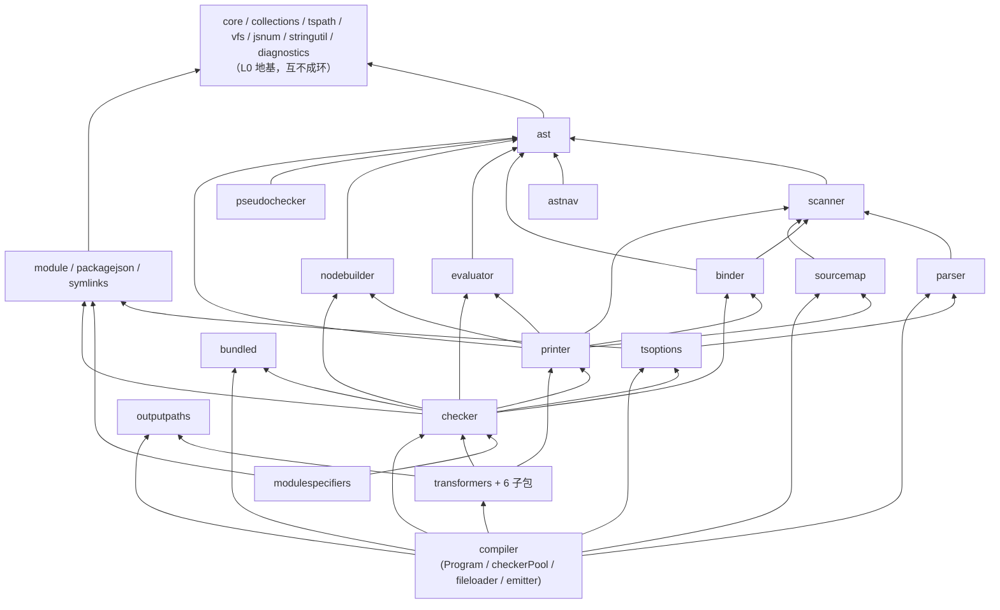
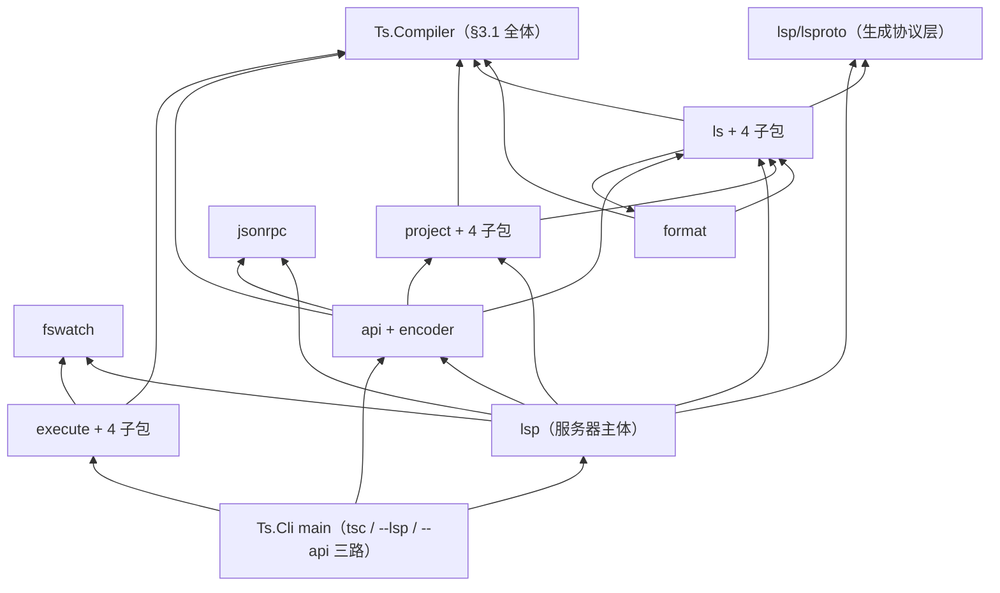

# 01 — 架构总览：程序集、依赖、线程与内存模型、保真策略、AOT 管线

| 元信息 | |
|---|---|
| 版本 | v1.0 |
| 日期 | 2026-07-11 |
| 状态 | Draft |
| 上游 | tsgo 源码 `/Users/token/Desktop/code/typescript-go-main`（钉扎策略见 00-overview.md） |
| 主计划 | `~/.claude/plans/precious-riding-hoare.md`（已批准；本文是其 §一 的架构展开） |

本文回答"整栋建筑长什么样"：程序集与命名空间布局、包级依赖 DAG、线程模型（checker 池 ×2、WorkGroup、LargeStackExecutor）、内存模型（GC 取代 Arena、保留的对象池）、UTF-16 决策全文、JSON 字节保真策略、AOT 发布管线、bundled:/// 覆盖 VFS。**逐包的文件级明细归 06-module-inventory.md；Go→C# 逐惯用法规则归 05-conventions.md；AOT 禁令细则归 07-aot-constraints.md**。所有源码论断附 `文件:行号`，均已对上游源码逐行核验。

---

## 1. 本文范围与阅读指南

- 动手移植某个包之前：先读本文 §2–§5 建立全局图景，再读 05-conventions.md 的逐惯用法表，最后读 06-module-inventory.md 里该包的条目。
- 本文**不引入**主计划之外的新架构决策；凡属实现细节的建议（如池的回收上限）均标注"建议值，非门禁"。发现的主计划模糊点集中列在 §10「待澄清」。

---

## 2. 程序集与命名空间布局

### 2.1 解决方案结构（复述主计划 §一.3，权威在主计划）

```
typescript-csharp/
  TypeScript.slnx
  Directory.Build.props        net10.0; Nullable enable; ImplicitUsings off;
                               InvariantGlobalization=true; IsAotCompatible + AOT/Trim analyzer 全开
  Directory.Packages.props     集中包版本（System.IO.Hashing / System.Threading.Channels / xunit.v3 …）
  _submodules/TypeScript/      官方 TypeScript 仓库，与 tsgo 钉扎同一 commit
  plan/                        本文档集
  tools/generator/  tools/dumptool/
  src/Ts.Compiler/             编译器全部（里程碑 1 主体）
  src/Ts.LanguageService/      ls/lsp/project/api/format/fswatch/jsonrpc（里程碑 2）→ 引用 Ts.Compiler
  src/Ts.Cli/                  tsgo 等价二进制（默认 tsc / --lsp / --api 三路复用），PublishAot=true
  tests/Ts.TestUtil | Ts.Compiler.Tests | Ts.Conformance.Tests | Ts.Fourslash.Tests | Ts.LanguageService.Tests
  testdata/baselines/reference/  49,323 个官方基线文件
```

项目引用方向（严格单向，MSBuild 强制）：

```
Ts.Cli ──▶ Ts.LanguageService ──▶ Ts.Compiler
tests/* ──▶ 以上任意 + Ts.TestUtil
```

### 2.2 命名空间映射规则

1. 根命名空间 `Ts`。Go 包 `internal/<pkg>` → 命名空间 `Ts.<Pkg>`（包名 PascalCase 化：`tsoptions`→`Ts.TsOptions`、`stringutil`→`Ts.StringUtil`、`jsnum`→`Ts.JsNum`、`sourcemap`→`Ts.SourceMap`、`modulespecifiers`→`Ts.ModuleSpecifiers`、`diagnosticwriter`→`Ts.DiagnosticWriter`）。
2. Go 子包 → 嵌套命名空间：`vfs/osvfs`→`Ts.Vfs.OsVfs`、`transformers/tstransforms`→`Ts.Transformers.TsTransforms`、`lsp/lsproto`→`Ts.Lsp.LsProto`、`execute/incremental`→`Ts.Execute.Incremental`、`ls/lsutil`→`Ts.Ls.LsUtil`。
3. 文件 1:1：Go 文件 → 同名 PascalCase `.cs`（`checkerpool.go`→`CheckerPool.cs`）；>15k 行巨文件按 Go 分节注释拆 partial class（拆分表在 06-module-inventory.md）。
4. 命名空间与文件夹一致：`src/Ts.Compiler/Checker/` ⇔ `Ts.Checker`。注意 Go 的 `internal/compiler` 包（Program/池/文件加载器）映射为命名空间 `Ts.Compiler`，与程序集同名——C# 允许，无冲突。

### 2.3 分层总表：41 个生产包 → 命名空间与项目归属

计数口径：`internal/` 下共 48 个顶层包。其中 **41 个为 1:1 移植对象**；4 个是测试资产（`fourslash`、`testrunner`、`testutil`、`repo`，归 tests/ 项目群）；3 个是 Go 平台垫片（`debug`、`json`、`pprof`），不占 1:1 名额——`debug`（61 行断言助手，被生产代码大量引用）吸收为 `Ts.Core.Debug` 静态类；`json`（100 行，对 go-json-experiment 的封装，`internal/json/json.go:1-20`）由 §7 的 STJ 策略取代，按消费点内联或落 `Ts.Core.Json` 薄助手；`pprof` 由 .NET 诊断设施（dotnet-trace / EventPipe）取代，见阶段 9。**逐包权威明细（文件清单、危险点、测试资产）以 06-module-inventory.md 为准**；下表给分层图景。LOC 为去 `_test.go`、去 testdata 的实测行数（2026-07 快照）。

**Ts.Compiler（33 包）**

| 层 | Go 包 | LOC | 命名空间 | 阶段 |
|---|---|---:|---|---|
| L0 地基 | core | 2,669 | Ts.Core | 1 |
| L0 | collections | 840 | Ts.Collections | 1 |
| L0 | tspath | 1,435 | Ts.TsPath | 1 |
| L0 | nativepath | 298 | Ts.NativePath | 1 |
| L0 | vfs（+8 子包 osvfs/iovfs/cachedvfs/trackingvfs/vfsmatch/vfsmock/vfstest/wrapvfs、internal） | 3,131 | Ts.Vfs.* | 1 |
| L0 | jsnum | 584 | Ts.JsNum | 1 |
| L0 | stringutil | 5,573 | Ts.StringUtil | 1 |
| L0 | glob | 349 | Ts.Glob | 1 |
| L0 | semver | 712 | Ts.Semver | 1 |
| L0 | packagejson | 662 | Ts.PackageJson | 4 |
| L0 | symlinks | 134 | Ts.Symlinks | 4 |
| L0 | diagnostics（+loc；主体生成，2,154 条消息） | 9,423 | Ts.Diagnostics | 0 |
| L0 | diagnosticwriter | 506 | Ts.DiagnosticWriter | 4 |
| L0 | tracing | 763 | Ts.Tracing | 9（接口占位在 0） |
| L0 | locale | 28 | Ts.Locale | 9 |
| L0 | bundled（108 个 lib.d.ts 内嵌，§9） | 1,110 | Ts.Bundled | 0 |
| L1 词法/AST | scanner | 4,256 | Ts.Scanner | 2 |
| L1 | ast（约半数生成） | 20,847 | Ts.Ast | 3 |
| L1 | astnav | 783 | Ts.AstNav | 3 |
| L2 语法 | parser | 9,071 | Ts.Parser | 3 |
| L3 绑定 | binder | 3,555 | Ts.Binder | 4 |
| L4 配置/解析 | tsoptions（+tsoptionstest→tests） | 6,144 | Ts.TsOptions | 4 |
| L4 | module | 2,780 | Ts.Module | 4 |
| L4 | modulespecifiers | 2,280 | Ts.ModuleSpecifiers | 5 |
| L5 检查 | checker | 59,822 | Ts.Checker | 5 |
| L5 | evaluator | 168 | Ts.Evaluator | 5 |
| L5 | nodebuilder | 78 | Ts.NodeBuilder | 5 |
| L5 | pseudochecker | 1,126 | Ts.PseudoChecker | 5 |
| L6 发射 | printer | 11,442 | Ts.Printer | 6 |
| L6 | transformers（+6 子包 tstransforms/estransforms/moduletransforms/jsxtransforms/declarations/inliners） | 24,323 | Ts.Transformers.* | 6 |
| L6 | sourcemap | 1,013 | Ts.SourceMap | 6 |
| L6 | outputpaths | 307 | Ts.OutputPaths | 6 |
| L7 驱动 | compiler（Program/checkerPool/fileloader/emitter） | 5,658 | Ts.Compiler | 4–6 |

**Ts.LanguageService（7 包）**

| Go 包 | LOC | 命名空间 | 阶段 |
|---|---:|---|---|
| ls（+autoimport/change/lsconv/lsutil） | 38,933 | Ts.Ls.* | 8 |
| format | 4,291 | Ts.Format | 8 |
| lsp（+lsproto[生成]/lspwatcher） | 21,008 | Ts.Lsp.* | 8 |
| project（+ata/background/dirty/logging） | 11,016 | Ts.Project.* | 8 |
| fswatch（FileSystemWatcher 重写） | 5,446 | Ts.FsWatch | 7/8 |
| jsonrpc | 287 | Ts.JsonRpc | 8 |
| api（+encoder[生成]） | 9,110 | Ts.Api.* | 9 |

**Ts.Cli（1 包）**

| Go 包 | LOC | 命名空间 | 阶段 |
|---|---:|---|---|
| execute（+build/incremental/tsc/watchmanager；tsctests→tests） | 9,348 | Ts.Execute.* | 7 |

execute 归 Ts.Cli 的理由：全仓只有 CLI 消费它，且它依赖 `fswatch`（位于 Ts.LanguageService，主计划 §一.3 将 FsWatch 列在服务层）——Ts.Cli 同时引用两个下层程序集，天然容纳。主计划目录树未明列 execute 归属，此判断列入 §10 待澄清第 1 条。

**测试资产（4 包 → tests/ 项目群）**：`testrunner`(889) 与 `testutil`(5,730，含 harnessutil/tsbaseline/baseline 等 14 子包) → Ts.TestUtil + Ts.Conformance.Tests；`fourslash`(9,770) → Ts.Fourslash.Tests；`repo`(87，仓库路径定位助手) → Ts.TestUtil 内的 RepoPaths 助手。

---

## 3. 包级依赖 DAG

依据：对全部包 import 语句的扫描（已剔除 `_test.go` 噪声边）。下图只画**主干承重边**；完整逐包依赖矩阵见 06-module-inventory.md。箭头语义：`A --> B` = A 依赖 B。

### 3.1 Ts.Compiler 内部 DAG



### 3.2 服务层叠加 DAG（Ts.LanguageService / Ts.Cli）



### 3.3 关键承重边说明（易被直觉画反的五条）

1. **printer 不依赖 checker**；反而 **checker 依赖 printer**（checker 内的 nodebuilder 实现用 `printer.EmitContext` 做类型→字符串打印）。这允许阶段 6 的 printer 与阶段 5 的 checker 长尾并行推进（主计划 §二排程依据）。
2. **transformers 依赖 checker**（类型指导的降级），所以 emit 全链在阶段 6 前无法闭环，但 printer 单体可先行。
3. **tsoptions 依赖 parser**：tsconfig 是用 TypeScript 解析器按 JSONC 解析的，不是通用 JSON 库——不要试图用 System.Text.Json 解析 tsconfig。
4. **ls ⇄ format 存在互相引用**（`format` 引 `ls/lsutil`，`ls` 引 `format`）。Go 靠子包切开环：`format` 只依赖 `ls/lsutil` 子包。C# 同构：`Ts.Ls.LsUtil` 独立命名空间/文件夹，`Ts.Format` 只引用它，程序集内无环问题但**保持同样的逻辑分层**，禁止 format 反向引用 `Ts.Ls` 主命名空间。
5. **checker 依赖 bundled**（识别 bundled:/// lib 文件路径），因此 bundled 必须在阶段 0 就绪（它几乎全是生成物，见 §9）。

---

## 4. 线程模型

### 4.1 并发不变量总纲（全部继承自 tsgo，逐条可验证）

| # | 不变量 | 来源 |
|---|---|---|
| T1 | Checker 内部无并发：单个 Checker 的所有方法调用必须持有其专属锁；类型/符号缓存均 per-checker | checker/checker.go:897-902（`mu sync.Mutex` 字段，`NewChecker` 把 `*Checker` 与 `*sync.Mutex` 成对返回） |
| T2 | 类型永不跨 checker 共享（`Type.checker` 反向指针），主计划 §一.2 | types.go |
| T3 | 文件→checker 静态钉扎：`files[i]` 归 `checkers[i % N]`，任何线程数下诊断输出与单线程全等（主计划 §四.3 确定性检验的机制基础） | compiler/checkerpool.go:114-117 |
| T4 | 并行结构统一经 `core.WorkGroup` 二态（并行/单线程）表达；`--singleThreaded` 一键全串行 | core/workgroup.go:20-25；compiler/program.go:446-448 |
| T5 | 所有深递归入口必须运行在大栈线程上（.NET 特有约束，§4.6） | 主计划 §一.5「0 号风险」 |
| T6 | AST 在 parse+bind 完成后对 checker 只读；bind 幂等由 `file.IsBound()`/`BindOnce` 保证 | binder/binder.go:96-101, 121-133 |

### 4.2 compiler 层 CheckerPool——批处理钉扎池（tsc 场景）

取证（compiler/checkerpool.go 全文已核验）：

- **接口**（:20-22）：`GetChecker(ctx, file) → (*checker.Checker, release func())`。返回的 checker 独占使用，用毕必须调 release；file 非空时作为亲和提示。
- **池尺寸**（:41-48）：默认 4；`SingleThreaded` 时 1；`Options().Checkers`（compileroptions.go:160 `Checkers *int`）可覆盖；最终钳位 `max(min(count, len(files), 256), 1)`。
- **惰性创建**（:98-118）：`sync.Once` 包裹；N 个 checker 用 WorkGroup **并行创建**（`checker.NewChecker` 本身很贵——它会触发 `program.BindSourceFiles()`，checker.go:903）；随后建立 `fileAssociations[file] = checkers[i % N]` 的静态钉扎（:114-117）。
- **获取路径**：file 为 nil → 恒取 `checkers[0]` 并锁 `locks[0]`（:62-72）；file 非空 → 查钉扎表、按下标锁对应 mutex（:82-90）。release 用 `sync.OnceFunc` 保证幂等（:69, :87）。
- **非独占读**（:74-80, :92-96）：`getCheckerForFileNonExclusive` 不加锁，仅限调用方能确保无并发写的只读场景（取 emit resolver）。
- **分组遍历**（:148-165）：`forEachCheckerGroupDo`——每 checker 一个任务，任务内按原始文件序扫全表、只处理钉给自己的文件。这是 `Program.collectCheckerDiagnosticsFromFiles`（program.go:585-591）的主路径：**每 checker 一把锁只锁一次**，消灭逐文件锁竞争，且组内文件序 = 全局文件序 ⇒ 诊断确定性。
- **全局诊断**（:136-143）：并行收集各 checker 的 global diagnostics 后 `SortAndDeduplicateDiagnostics` 合并。

C# 映射（`src/Ts.Compiler/Compiler/CheckerPool.cs`）：

```csharp
namespace Ts.Compiler;

// Go: compiler/checkerpool.go:20-22
public interface ICheckerPool
{
    (Checker Checker, Action Release) GetChecker(RequestContext ctx, SourceFile? file);
}

internal sealed class CheckerPool : ICheckerPool
{
    private readonly Program _program;
    private readonly Tracing? _tracing;
    private readonly Checker[] _checkers;                 // 长度即池大小
    private readonly Lock[] _locks;                       // 每 checker 一把（T1）
    private Dictionary<SourceFile, Checker>? _fileAssociations; // 引用相等键
    private readonly Lock _createLock = new();            // createCheckersOnce
    private volatile bool _created;

    // GetChecker / GetCheckerForFileExclusive / GetCheckerForFileNonExclusive /
    // ForEachCheckerParallel / ForEachCheckerGroupDo / GetGlobalDiagnostics
    // —— 逐函数直译 checkerpool.go:62-165
}
```

映射要点：

| Go | C# | 备注 |
|---|---|---|
| `sync.Once createCheckersOnce` | `Lock + volatile bool` 双检 | 初始化体内含 WorkGroup 并行，不宜用 `Lazy<T>`（异常缓存语义不同） |
| `[]*sync.Mutex locks` | `Lock[]`（`System.Threading.Lock`） | 二者均不可重入，语义对齐；`NewChecker` 返回的锁即 `Checker` 内部字段（checker.go:897），C# 做法：`Checker` 暴露 `internal Lock Mu`，池收集之 |
| `sync.OnceFunc(release)` | `Ts.Core.OnceAction.Wrap(Action)`：`Interlocked.Exchange` 置位后至多执行一次 | release 幂等是池正确性前提 |
| `map[*ast.SourceFile]*checker.Checker` | `Dictionary<SourceFile, Checker>`，`ReferenceEqualityComparer.Instance` | Go 指针键 = 引用同一性（主计划 §一.6） |
| `slices.Index(p.checkers, c)`（:85） | `Array.IndexOf(_checkers, c)` | |
| `ctx context.Context` | `RequestContext`（§4.4） | compiler 层只消费取消位 |

### 4.3 project 层 checkerPool——请求作用域三类池（LSP 场景）

取证（project/checkerpool.go 全文已核验）。与 compiler 池同名但**完全不同的机器**，实现同一 `CheckerPool` 接口（:82）：

- **三类 checker**（:32-40 注释 + 结构）：
  1. **诊断 checker（index 0，专用）**：LSP 诊断恒用它，保证遍历序一致 ⇒ 诊断输出稳定。可空闲回收。
  2. **临时查询 checker（index 1..MaxCheckers-1）**：hover/补全等临时查询用；空闲超时（默认 30s，:28-29, :90-92）回收（:428-456）。
  3. **API 持久 checker（独立字段 `persistentChecker`，:67-70）**：为 API 客户端的 type/symbol 句柄提供**稳定实例同一性**（引用相等），**永不空闲回收**。
- **路由依据**（:123-143）：从 ctx 取 `core.GetCheckerLifetime`（Diagnostics/API/Temporary 三值，core/context.go:25-41）与 `core.GetRequestID`；`ctx.Done()==nil`（不可取消的背景 ctx）时禁用请求亲和以防 `requestAssociations` 无界增长（:127-133）。
- **限流**：三条信号量通道 `diagSem`(容量 1) / `querySem`(容量 MaxCheckers−1) / `persistentSem`(容量 1)（:72-74, :102-104）。
- **请求亲和**（:157-216）：同一 requestID 重入时直接返还其已持 checker（不再占槽）或重取；亲和登记经 `context.AfterFunc` 在请求结束时清理（:384-390）。
- **文件亲和**（:261-275）：file → 查询 checker 下标（仅 1+），尽量复用已建缓存。
- **取消即弃**（:349-353, :332-339）：`checker.WasCanceled()` 的 checker 复用会 panic，release 时直接 dispose；持久 checker 被取消也弃置、下次重建。
- **空闲回收**（:396-456）：单只 `time.Timer` 按最早到期时间调度；dispose 时清空该下标的全部文件/请求亲和（:460-476）。
- **全局诊断累积**（:481-510）：release 时增量合并各 checker 的 global diagnostics。
- **Discard**（:516-528）：program 被替换后停表不再回收——让 API 句柄在旧池 GC 前仍可解析。

**两池对照**：

| 维度 | compiler 池 | project 池 |
|---|---|---|
| 生命周期 | 与一次编译等长，固定 N | 与 project 版本等长，动态创建/空闲回收 |
| 分配策略 | `index % N` 静态钉扎 | 请求亲和 > 文件亲和 > 任意空闲/新建 |
| 排它机制 | 每 checker 一把 Lock | heldBy 标记 + 信号量限流 + 全池一把 mu |
| 特殊席位 | `checkers[0]`＝无文件请求的默认席 | index 0＝诊断专席；persistent＝API 专席 |
| 确定性来源 | 钉扎 + 组内原始文件序 | 诊断恒走同一 checker |

C# 映射（`src/Ts.LanguageService/Project/CheckerPool.cs`）：

| Go | C# |
|---|---|
| `mu sync.Mutex` | `Lock _mu`（`using _mu.EnterScope()` 对应 defer Unlock） |
| `chan struct{}`（容量 N 信号量） | `SemaphoreSlim(N, N)`；`sem <- struct{}{}` → `.Wait()`；`<-sem` → `.Release()`。保持与 Go 相同的**不可取消阻塞**语义（取消在 checker 层生效，不在池入口） |
| `time.Timer` + `AfterFunc` + `Reset/Stop`（:415-423） | 单只 `System.Threading.Timer`，`Change(delay, Timeout.Infinite)` 实现一次性重调度；回调重入保护沿用 Go 的 discarded 检查（:433-436） |
| `context.AfterFunc(ctx, cleanup)`（:385） | `ctx.CancellationToken.Register(cleanup)`；返回的 registration 保存以便池销毁时 Dispose |
| `time.Time lastReleased` + `IsZero()` 哨兵 | `long?[] _lastReleasedTicks`（`Environment.TickCount64`，单调时钟；null＝零值哨兵） |
| `heldBy []string` + `checkerHeldAnonymous`（:20） | 同构 `string?[]`，`"<anonymous>"` 哨兵原样保留 |
| `debug.Assert`（:461） | `Ts.Core.Debug.Assert` |

### 4.4 RequestContext——context.Context 的显式替身

Go 用 `context.Context` 携带三样东西过池边界：取消、requestID（`core.GetRequestID`）、checker 生命周期类别（core/context.go:25-41）。C# 禁用 AsyncLocal 隐式流动（AOT 下可用但不透明、难审计），改为**显式传参的不可变小对象**：

```csharp
namespace Ts.Core;

public enum CheckerLifetime { Temporary, Diagnostics, Api }   // core/context.go:28-31

public readonly struct RequestContext
{
    public CancellationToken Cancellation { get; init; }
    public string RequestId { get; init; }            // "" = 无
    public CheckerLifetime CheckerLifetime { get; init; }
    public bool CanBeCanceled => Cancellation.CanBeCanceled;  // 对应 ctx.Done()==nil 判定(:131)

    public RequestContext WithCheckerLifetime(CheckerLifetime lt) => this with { CheckerLifetime = lt };
    public static RequestContext Background => default;
}
```

签名规则：Go 函数第一参 `ctx context.Context` → C# 第一参 `RequestContext ctx`（仅需取消位的深层函数可降为 `CancellationToken`，逐案表在 05-conventions.md）。

### 4.5 core.WorkGroup 的 C# 接口设计

取证（core/workgroup.go 全文已核验）：

- 接口二方法（:11-18）：`Queue(fn)`（并行实现**立即起 goroutine**，:34-42；单线程实现仅入队，:57-65）+ `RunAndWait()`。
- `RunAndWait` 返回后再 `Queue` 是 panic（:36, :58-60，`atomic.Bool done`）。
- **单线程实现按 LIFO 弹出执行**（:78-89，从尾部 pop），且执行中新 Queue 的任务同样会被弹出——文件加载器靠这一点做递归发现（每个解析任务把新发现的 import 继续 Queue：compiler/fileloader.go:142, :309；compiler/filesparser.go:206 持有 `wg core.WorkGroup` 字段）。**两实现都必须支持任务执行中再入 Queue**。
- 附属物 `ThrottleGroup`（:92-124，信号量限流的 errgroup）仅 1 个生产使用点（project/ata/ata.go:286）→ C# 以 `SemaphoreSlim + Task.WhenAll` 直译，随阶段 8 移植，不进核心接口。

C# 设计（`src/Ts.Compiler/Core/WorkGroup.cs`）：

```csharp
namespace Ts.Core;

public interface IWorkGroup
{
    void Queue(Action fn);   // RunAndWait 返回后调用 → InvalidOperationException（对应 panic）
    void RunAndWait();
}

public static class WorkGroup
{
    // Go: core.NewWorkGroup(singleThreaded)
    public static IWorkGroup Create(bool singleThreaded) =>
        singleThreaded ? new SingleThreadedWorkGroup() : new ParallelWorkGroup(LargeStackExecutor.Default);
}
```

实现约定：

1. `SingleThreadedWorkGroup`：`List<Action>` + 尾部 LIFO 弹出，直译 :49-89（含 `fns[end]=nil` 的清引用，C# 同样置 null 让 GC 回收闭包）；`RunAndWait` 在**当前线程**内联执行——入口已保证在大栈线程（§4.6 规则 E1）。
2. `ParallelWorkGroup`：`Queue` 立即把任务提交到 `LargeStackExecutor`（对应"立即起 goroutine"），内部用计数器（`Interlocked` + `ManualResetEventSlim`）实现 Join；任务体内再 `Queue` 直接追加计数——天然支持递归入队。
3. `done` 守卫：`volatile bool` + 违规抛 `InvalidOperationException`。
4. **禁用 `Task.Run`/默认线程池承载 WorkGroup 任务**：默认 ThreadPool 线程栈 ~1MB，跑 parse/bind/check 必炸（T5）。这是 ParallelWorkGroup 构造函数注入 LargeStackExecutor 的原因，也是全仓 code review 红线（07-aot-constraints.md 收录 analyzer/审查项）。

### 4.6 LargeStackExecutor——64MB 大栈执行器（0 号风险的对策）

**问题**：Go 协程栈按需增长（默认可至 1GB），tsgo 的 parser/binder/checker/printer 都是深递归（原版 tsc.js 需要 `--stack-size` 才能跑 conformance）；.NET 线程栈固定（主线程/线程池 ~1-8MB），不换栈必然 StackOverflowException 且不可捕获、直接进程崩溃。**对策**（主计划 §一.5）：所有深递归入口一律跑在 64MB 专用线程上。64MB 是**虚拟保留**，物理页按触碰提交，空闲 worker 的真实内存代价接近零。

API 草案（`src/Ts.Compiler/Core/LargeStackExecutor.cs`）：

```csharp
namespace Ts.Core;

public sealed class LargeStackExecutor : IDisposable
{
    public const int DefaultStackSize = 64 * 1024 * 1024;      // tsc.js --stack-size 对应物
    public static LargeStackExecutor Default { get; }           // 进程级单例；TSGO_CS_STACK_SIZE 环境变量可覆盖尺寸（诊断用）

    [ThreadStatic] private static bool t_onLargeStack;
    public static bool OnLargeStackThread => t_onLargeStack;

    public void Run(Action action);                  // 已在大栈线程 → 内联执行；否则派发并阻塞等待。异常经 ExceptionDispatchInfo 原栈语义重抛
    public TResult Run<TResult>(Func<TResult> func);
    public Task RunAsync(Action action, CancellationToken ct = default);      // LSP/API 异步入口
    public Task<TResult> RunAsync<TResult>(Func<TResult> func, CancellationToken ct = default);

    internal void Schedule(Action action);           // 仅供 ParallelWorkGroup：入队不等待（≈ go fn()）
}
```

实现规格：

- **worker 线程**：`new Thread(WorkerLoop, maxStackSize: DefaultStackSize) { IsBackground = true, Name = $"ts-bigstack-{i}" }`；任务队列用 `System.Threading.Channels` 的无界 Channel（依赖映射表：channel→Channels，主计划 §一.5）。
- **池尺寸**：按需创建；软上限 `Environment.ProcessorCount`；**防饥饿增长**：当全部 worker 都阻塞在嵌套 `RunAndWait`（见下）且队列非空时允许临时超限增新线程——近似 goroutine "阻塞让出"语义的最小代偿。
- **嵌套并行是常态，必须防死锁**。实证链：checkerPool.createCheckers 用 WorkGroup 并行创建 4 个 checker（compiler/checkerpool.go:101-112），而 `checker.NewChecker` 第一行就调 `program.BindSourceFiles()`（checker/checker.go:903），后者又开一个 WorkGroup（program.go:451）。两级机制兜底：
  1. **RunAndWait 内联帮工**：`ParallelWorkGroup.RunAndWait` 在等待期间从**本组**待执行队列拉任务在当前线程执行（当前线程必为大栈线程，安全），队列空后才真正阻塞等 in-flight 计数归零——即使池饱和也自我推进；
  2. 上述防饥饿增长兜底跨组阻塞。
- **异常**：任务异常存入完成源，`Run` 处 rethrow；对应 Go panic 冒泡语义（panic→异常总则见 05-conventions.md）。

**必须经由 LargeStackExecutor 的入口清单**（E 规则，Debug 构建在这些入口 `Debug.Assert(OnLargeStackThread)`）：

| # | 入口 | Go 位置 | 进入途径 |
|---|---|---|---|
| E1 | `ParseSourceFile`（含 JSON 文本解析） | parser/parser.go:136 | fileloader 的 WorkGroup 任务（已是大栈线程）；独立调用点（LS 单文件重解析等）自行 `Run()` |
| E2 | `BindSourceFile` | binder/binder.go:96 | `Program.BindSourceFiles` 的 WorkGroup 任务（program.go:451-459） |
| E3 | `Checker` 全部入口：构造（`NewChecker`，checker/checker.go:902，构造即触发 bind）与所有公共方法（GetDiagnostics/GetTypeOfSymbol/GetSymbolAtLocation/…——checker 任何 API 都可能触发任意深的类型解析递归） | checker 包 | checkerPool 创建路径（compiler/checkerpool.go:101）天然在大栈；**所有 `GetChecker(...)` 消费点是重点审计面**：消费方线程必须已是大栈线程 |
| E4 | printer/emit 递归（`Program.Emit` 的逐文件任务，含 transformers visitor 递归） | compiler/program.go:1655-1670 | emit 的 WorkGroup 任务 |
| E5 | LSP 请求处理器（一切可能触达 E1–E4 的 handler） | lsp/server | dispatcher 以 `RunAsync` 承载 handler 主体 |
| E6 | CLI 主流程 | Ts.Cli `Program.Main` | main 整体包一层 `Run()`（Go 的 main goroutine 栈本身可增长；.NET 主线程不行） |
| E7 | 测试宿主 | tests/* | Ts.TestUtil 提供 `RunOnLargeStack` xUnit 包装；conformance 跑批器全程在大栈线程 |

验证钩子（详见 08-testing-strategy.md）：阶段 3 起 CI 常备"深嵌套金丝雀"语料（超深二元表达式链/嵌套条件类型），JIT 与 AOT 产物都要过——栈溢出在 .NET 是进程死，必须靠金丝雀提前暴露而非事后调试。

### 4.7 其他并发原语映射速查（全表在 05-conventions.md）

| Go | C# | 本文相关用点 |
|---|---|---|
| `sync.Mutex` | `System.Threading.Lock` | checker 锁、池 mu |
| `sync.RWMutex` | `ReaderWriterLockSlim` | vfs 缓存等 |
| `sync.Once` / `sync.OnceFunc` / `sync.OnceValue` | Lock+flag 双检 / `OnceAction.Wrap` / `Lazy<T>`（无副作用纯值时） | createCheckers、release、bundled 内容表 |
| `chan struct{}`（信号量用法） | `SemaphoreSlim` | project 池三通道 |
| `chan T`（数据管道） | `System.Threading.Channels.Channel<T>` | LSP 读写循环、LargeStackExecutor 队列 |
| `go fn()` | `LargeStackExecutor.Schedule`（深递归域）/ `Task.Run`（纯 IO 浅栈域，如 fswatch 事件泵） | |
| `atomic.Bool/Uint32/...` | `Interlocked` + `Volatile` | WorkGroup done、nextCheckerID（checker.go:578） |
| `context.Context` | `RequestContext` / `CancellationToken`（§4.4） | 池路由 |
| `errgroup` / `ThrottleGroup` | `Task.WhenAll` + `SemaphoreSlim` | ata.go:286 |

---

## 5. 内存模型

### 5.1 GC 取代全部 ~50 个 Arena 的论证

tsgo 用 arena（批量 bump 分配 + 整块存活）优化两件事：分配吞吐、同代局部性。逐点论证 .NET 直接删除 arena 层（主计划 §一.1 决策，`arena.New()` → `new T()` 全局约定）：

1. **分配吞吐**：.NET gen0 分配即指针 bump（allocation context），单次分配成本与 arena.New 同量级；Go 的常规堆分配反而要走 size-class/mcache。arena 在 Go 侧是对其分配器的补偿，在 .NET 侧没有等价收益。
2. **存活模式匹配分代假设为反**——AST/Symbol/Type 一旦建成几乎全程存活到进程尾（tsc 场景）。这意味着 gen2 常驻、无反复复制；一次编译进程的 full GC 次数有限。LSP 长驻场景由 program 版本更替产生代际死亡波，恰是分代 GC 的经典负载。
3. **arena 的整块释放优势在 tsgo 中本就未兑现**：tsgo 不在编译中途释放 arena（AST 与类型活到进程尾/program 弃置），拿不到"提前整块归还"的收益。
4. **风险承认与兜底**：这是性能论断而非正确性论断。若阶段 10 基准显示 GC 压力超标（门禁：性能 ≤2× tsgo，主计划 §二阶段 7/10），调优顺序为 GC 档位（§5.4）→ 结构体化小对象 → 最后才考虑 `ArrayPool`/分块 freelist 局部回补。风险与触发器记入 12-risks.md「GC vs arena 性能」条目。

### 5.2 保留的对象池清单 → `ObjectPool<T>`

arena 删除，但 tsgo 的 **sync.Pool**（复用昂贵可重置对象，与 arena 目的不同）保留语义。全仓生产代码 sync.Pool 共 9 处（已 grep 核验）：

| # | Go 位置 | 池内容 | C# 归宿 |
|---|---|---|---|
| P1 | parser/parser.go:122 `parserPool` | Parser 实例（含 scanner、`setParentFromContext` 闭包） | `ObjectPool<Parser>` |
| P2 | binder/binder.go:104 `binderPool` | Binder 实例（含 `bindFunc` 闭包） | `ObjectPool<Binder>` |
| P3 | printer/emitcontext.go:51 `emitContextPool` | EmitContext | `ObjectPool<EmitContext>` |
| P4 | printer/singlelinestringwriter.go:13 | 单行字符串 writer | `ObjectPool<SingleLineStringWriter>` |
| P5 | ast/utilities.go:871 `setParentInChildrenPool` | setParent 访问器状态 | `ObjectPool<T>` 同构 |
| P6 | compiler/filesparser.go:211 `parseTaskDataPool` | 解析任务暂存 | `ObjectPool<T>` 同构 |
| P7 | compiler/program.go:1650 emit `writerPool`（局部变量池） | emit 文本 writer | 局部 `ObjectPool<EmitTextWriter>`，作用域同 Go |
| P8 | core/core.go:607 `levenshteinBuffersPool` | 拼写建议缓冲 | `ObjectPool<T>` 或直接栈上 `Span` 化（阶段 1 定，允许简化：纯内部缓冲无观察面） |
| P9 | vfs/osvfs/os.go:118 `limitedWalkDirFuncPool` | 目录遍历闭包 | Go 逃逸分析特调，C# 可不池化（无观察面），06 清单标注 |

`Ts.Core.ObjectPool<T>` API：

```csharp
namespace Ts.Core;

public sealed class ObjectPool<T> where T : class
{
    public ObjectPool(Func<T> factory, Action<T>? reset = null, int maxRetained = -1); // -1=2×CPU（建议值，非门禁）
    public T Get();
    public void Return(T item);                    // 先 reset 后入池
    public Rental Rent(out T item);                // ref struct，using 模式 ≙ defer putX(p)
}
```

语义差异声明：`sync.Pool` 会在 GC 时清空、且 per-P 分片；`ObjectPool<T>` 用 `ConcurrentQueue` + 保留上限。差异**纯性能无正确性影响**——前提是重置完整。因此立硬规则：**每个池的 reset 委托必须与 Go 的 put 函数逐字段对照**（`putParser` 保留 `scanner`/`setParentFromContext` 其余全清，parser.go:131-134；`putBinder` 保留 `bindFunc` 其余全清，binder.go:115-118）。池对象残留状态 = 跨文件不确定性 bug，是 conformance 最难排查的一类，列入 code review checklist（05-conventions.md）与 12-risks.md。

### 5.3 对象身份与惰性 id

- Node/Symbol/Type 身份 = **引用同一性**（Go 指针比较 → C# 引用比较；LinkStore/fileAssociations 等一律 `ReferenceEqualityComparer`）。
- Node.id / Type.id 惰性分配：`Interlocked.CompareExchange`（主计划 §一.1 Node 布局）；checker id 计数器对应 `nextCheckerID atomic.Uint32`（checker/checker.go:578）→ `Interlocked.Increment`。
- 结构键缓存 → `readonly record struct`（主计划 §一.6，细节归 03-checker-design.md）。

### 5.4 GC 配置基线

- 初始姿态：CLI（Ts.Cli tsc 路径）与测试跑 Workstation GC + Concurrent（短进程启动开销小）；LSP 长驻路径评估 Server GC + DATAS。
- **不在本阶段定死**：阶段 10 门禁用 BenchmarkDotNet 对 tsgo 实测后落 `runtimeconfig` 模板（主计划 §二阶段 10「ServerGC 调优」）。配置只影响性能不影响输出字节，任何档位下 conformance 必须全等（这本身是阶段 10 的回归项）。

---

## 6. UTF-16 决策（全文）

### 6.1 决策

**一切源码位置（pos/end/行/列）以 UTF-16 code unit 计**，与原版 tsc（JS 字符串语义）一致；**整体删除** tsgo 的 UTF-8 偏移 + `PositionMap` + rune 换算机制。这是全移植唯一的净简化：C# `string` 原生 UTF-16，`TextRange{int Pos; int End}` 直接是 code unit 偏移，scanner 按 `char` 索引扫描，代理对逻辑照搬 tsc 语义。

### 6.2 证据链（主计划对抗验证第 3 项，判定 PARTIAL 后修正如下）

- **没有任何基线写出器打印 UTF-8 字节偏移**：errors.txt 行列头、相关信息位置、.types/.symbols 的 `Decl(行,列)`、CLI 诊断、sourcemap 列全部经 UTF-16 换算输出。CLI 侧佐证：diagnosticwriter 波浪线宽度按 `core.UTF16Len(lineContent)` 计（diagnosticwriter/diagnosticwriter.go:246）。
- **判别性证据**：`regularExpressionWithNonBMPFlags.errors.txt` 的 `(7,23)` 是 UTF-16 列（若按 UTF-8 字节应为 33）。
- `PositionMap` 仅服务 API/LS 线缆层换算，删除对基线一致性安全。

### 6.3 全链影响

| 领域 | 约定 |
|---|---|
| Scanner/AST/诊断 | pos/end/宽度均 UTF-16 code unit；`TextRange` = `struct{int Pos; int End;}` |
| 文件读入 | vfs 读字节 → UTF-8 解码为 `string`（BOM 按 tsgo 规则处理）；**无效 UTF-8 序列 → U+FFFD**（与 Go `[]byte→string` 迭代语义对齐，也与 §7 JSON 写出的 U+FFFD 规则闭环） |
| sourcemap | 生成的 .js.map 列号即 UTF-16（tsc 语义），无需换算 |
| LSP | 协议默认 `utf-16` 编码 ⇒ 原来 tsgo 需要 PositionMap 的地方 C# 恒等映射，负成本 |
| dumptool 夹具 | Go 侧导出前已经 PositionMap 预转 UTF-16（主计划 §二），两侧可直接 diff |
| 代理对 | 不做任何"字符完整性"修正：孤立代理照 tsc 行为原样通过 scanner（C# string 允许孤立代理，行为面与 JS 一致） |

### 6.4 两个刻意的基架垫片（测试基架，不在编译器本体）

1. **errors.txt 波浪线按 Unicode 码点计数**。Go 写出器按 rune 数打波浪线：`strings.Repeat("~", utf8.RuneCountInString(line[squiggleStart:squiggleEnd]))`（testutil/tsbaseline/error_baseline.go:214）——星面字符（BMP 外，UTF-16 占 2 code unit）只产生 1 个 `~`。若 C# 直接用 `string.Length` 会打出 2 个，至少 3 个含星面字符的基线会 diff。垫片：该处（且仅该处）用 `Rune` 枚举计数（`text.EnumerateRunes().Count()`）。
2. **.sourcemap.txt 记录器续行标记的终列 = JS 行的 UTF-8 字节长 − 1**。Go 用 `len(jsFileText)-1`（Go `len(string)` 是字节长）：testutil/harnessutil/sourcemap_recorder.go:351-353。垫片：C# 该处用 `Encoding.UTF8.GetByteCount(jsFileText) - 1`，并加注释说明这是复刻 Go/Strada 的字节语义（上游注释自认 "Strada is wrong here"——错也要错得一样，基线保真高于优雅）。

### 6.5 休眠路径备案

type_symbol_baseline.go:236 的下划线按字节 pad，但该代码路径当前未启用——不做垫片，记入 12-risks.md（触发条件：上游启用该路径的同步升级时）。

---

## 7. JSON 字节保真策略

适用面：`.tsbuildinfo` 写出/读回、基线中的 JSON 片段、`--showConfig`。目标：**与 tsgo 输出逐字节相等**（阶段 7 门禁）。以下八条为强制规格（主计划 §一.5，已对 Go 输出形态核验）：

1. **编码器**：`Utf8JsonWriter` + `JavaScriptEncoder.UnsafeRelaxedJsonEscaping`。.NET 默认编码器会转义 `<` `>` `&` 与全部非 ASCII —— 直接破坏字节保真，全仓封禁默认编码器（07-aot-constraints.md 落 analyzer/审查项）。
2. **键序 = Go struct 声明序**。`BuildInfo` 19 字段的声明序（execute/incremental/buildInfo.go:462 起）就是输出序；C# 写出代码按同序手写/生成，禁止依赖任何字典迭代序。
3. **omitzero 语义**：字段为 `false`/`0`/`""`/null 时整个键省略——用逐字段 `if` 手工控制，不用特性驱动的序列化。
4. **七种多态形状**（buildInfo.go:34-448）：`BuildInfoRoot` 为 `number | [start, end]`、file 条目为 `string | 对象` 等共七种 union 形状——每种写一个手工 `Write` 方法 + 对应手工 `Utf8JsonReader` 读回；形状清单与逐一签名归 04-codegen.md / 阶段 7 WBS。
5. **字符规则**：控制字符短转义（`\n` `\t`）；非 ASCII 直通不转义；无效序列/孤立代理 → U+FFFD（与 §6.3 解码规则闭环）。
6. **版式**：单行紧凑、无空格、无尾换行。buildinfo 数值只有整数，无浮点写出路径（数字版式风险隔离在 jsnum，阶段 1 门禁）。
7. **version 哨兵**：`version` 字段 = `core.Version()` 的精确字符串（`"7.1.0-dev"`，core/version.go:8-12，Go 侧可被 ldflags 覆盖 → C# 侧等价物为 MSBuild 常量注入）；读回时精确相等校验，不等则弃用整个 buildinfo。
8. **实现形态**：STJ **仅源生成上下文**（LSP 协议层 Protocol.g.cs 那族）；buildinfo/showconfig 这类字节保真面**直接手写 Utf8JsonWriter 调用**，不经对象序列化器——序列化器的键序/省略/转义控制面不够。反射序列化器全仓封禁（AOT 铁律，07-aot-constraints.md）。

测试基架配套：readable-baseline 写出器（2 空格缩进 + `size=` 紧凑文本字节长）归 08-testing-strategy.md。

关联：`.tsbuildinfo` 中 `version`/`signature` 字段的 xxh3-128 小写 hex（**对 UTF-8 字节哈希**，非 UTF-16；固定测试向量见主计划 §一.6）由 `System.IO.Hashing.XxHash128` 提供，规格归 03-checker-design.md/08。

---

## 8. AOT 发布管线

### 8.1 RID 矩阵

| RID | 构建宿主 | 说明 |
|---|---|---|
| osx-arm64 | macos arm64 runner | 主力开发平台 |
| osx-x64 | 同一 macOS runner 交叉产出（Xcode 工具链支持双 arch） | |
| linux-x64 | ubuntu x64 runner | |
| linux-arm64 | 优先原生 arm64 runner；备选 x64 + clang 交叉工具链 + arm64 sysroot（官方支持路径） | |
| win-x64 | windows x64 runner | |
| win-arm64 | 由 win-x64 runner 交叉产出（Windows 目标间交叉官方支持） | |

铁律：**Native AOT 不支持跨 OS 编译**——三 OS 各需真实 runner；架构内交叉按上表。

### 8.2 MSBuild / ILC 设置

`Directory.Build.props`（全体项目）：

```xml
<TargetFramework>net10.0</TargetFramework>
<Nullable>enable</Nullable>
<ImplicitUsings>disable</ImplicitUsings>
<InvariantGlobalization>true</InvariantGlobalization>   <!-- ordinal 语义审计见 07 -->
<IsAotCompatible>true</IsAotCompatible>                 <!-- src/* 库项目 -->
<EnableAotAnalyzer>true</EnableAotAnalyzer>
<EnableTrimAnalyzer>true</EnableTrimAnalyzer>
<EnableSingleFileAnalyzer>true</EnableSingleFileAnalyzer>
<WarningsAsErrors>$(WarningsAsErrors);IL2000-IL3999</WarningsAsErrors> <!-- 表意；实际以具体 IL 码清单落地，见 07 -->
```

`Ts.Cli.csproj` 追加：

```xml
<PublishAot>true</PublishAot>
<StackTraceSupport>true</StackTraceSupport>  <!-- 保留栈迹换诊断力，体积代价已计入预期 -->
```

`OptimizationPreference`/`StripSymbols`（连同 ServerGC）为**阶段 10 调优候选旋钮，初始一律不设**；该属性集的唯一权威为 07-aot-constraints.md §3.5（裁决 R4；实际脚手架 Ts.Cli.csproj 已照此落地）。

测试项目不 AOT（跑 JIT 求快），但阶段门禁对**已发布 AOT 二进制**复跑一致性套件（§8.4）。发布命令统一封装为脚本：`dotnet publish src/Ts.Cli -c Release -r <rid>`。

### 8.3 体积预期与监控

- 组成估算：AOT 基底 + 本体代码（30 万行级 → 编译器体在 20–50MB 量级）+ 内嵌 lib.d.ts（源 3.9MB，EmbeddedResource 不压缩直存）+ 诊断消息表 + Unicode 表（RVA 静态数据）。
- **预期带**：单二进制 30–80MB/RID；对标物：tsgo 同平台发布二进制。**监控项而非硬门禁**：CI 每次发布记录各 RID 字节数入 11-progress.md 趋势表；相邻记录膨胀 >10% 自动告警并要求归因（新生成物？ILC 选项漂移？）。
- 体积削减备选（仅在越带时动用，按序）：`InvariantTimezone`、关闭 `StackTraceSupport`、lib.d.ts 压缩内嵌（Brotli + 启动解压——会引入启动开销与 Go 行为差异，谨慎）。

### 8.4 双轨验证管线（主计划 §四.2）

```
日常 PR：JIT 跑单测 + 当前阶段夹具 diff（快）
阶段门禁：三 OS matrix →
  dotnet publish (6 RID) → AOT/Trim analyzer 零警告 →
  对发布二进制复跑一致性套件（conformance/夹具，捕获 AOT 特有分歧：反射缺口、裁剪缺口、数值/时区/文化差异）→
  栈金丝雀（§4.6）在 AOT 二进制上必过 →
  记录二进制体积
```

阶段 0 出口即要求三平台 hello-CLI `publish /p:PublishAot=true` 通过（主计划 §二阶段 0）；阶段 7 出口要求 AOT 二进制编译真实大项目输出与 tsgo 全等且性能 ≤2×。

---

## 9. bundled:/// URI scheme 覆盖 VFS 方案

### 9.1 Go 侧机制（bundled/embed.go、bundled.go 全文已核验）

- scheme 常量 `"bundled:///"`（embed.go:15）；`LibPath()` = `"bundled:///libs"`（embed.go:21-23）；`IsBundled(path)` = 前缀判断（embed.go:25-28，`strings.CutPrefix`，**ordinal 区分大小写**）。
- `WrapFS(fs)` 返回装饰器 `wrappedFS`（bundled.go:23-26、embed.go:41-43）：凡命中 scheme 前缀的路径由内嵌表服务，其余透传内层 vfs。逐方法行为：
  - `FileExists`/`ReadFile`：查 `embeddedContents[rest]`（embed.go:49-63）；内容表由 `go:embed` 逐 lib 生成（embed_generated.go），键形如 `libs/lib.es2015.d.ts`。
  - `DirectoryExists`：仅 `libs` 为真（embed.go:65-70）。
  - `GetAccessibleEntries`：根 → `Directories=["libs"]`；`libs` → `Files=LibNames`（embed.go:72-82）；`LibNames` 为按名排序的 108 个文件清单（libs_generated.go:5-8，`internal/bundled/libs/` 实数 108，与主计划一致）。
  - `Stat`：`""`/`"libs"` 返回目录信息；文件 size = `len(lib)` 即 **UTF-8 字节长**（embed.go:88-100）。
  - `WalkDir`：在合成目录树上遍历，正确处理 SkipAll/SkipDir（embed.go:102-146）。
  - `Realpath`：恒等（embed.go:148-153）——bundled 路径不做任何规范化/大小写折叠。
  - 写族 `WriteFile/AppendFile/Remove/Chtimes`：panic（embed.go:155-181）。
- vfs 合同以 **string 为内容类型**（embed.go:30-33 注释：绕开 fs.FS 以避免 []byte↔string 拷贝）。
- `noembed.go` 是 `-tags noembed` 的开发变体（从磁盘读）；`TestingLibPath()` 供测试直读源码目录（bundled.go:41-52）。

### 9.2 C# 映射（`src/Ts.Compiler/Bundled/`）

| Go | C# |
|---|---|
| `go:embed libs/*`（embed_generated.go） | csproj：`<EmbeddedResource Include="Bundled/libs/**/*.d.ts" />`（108 个文件由拷贝脚本从子模块同步，流程归 04-codegen.md） |
| `embeddedContents map[string]string` | `static readonly Lazy<Dictionary<string, string>>`（ordinal 键）：首次访问时枚举 `Assembly.GetManifestResourceStream` 逐个 UTF-8 解码为 `string` 缓存——保持"内容即 string"的 vfs 合同 |
| `LibNames []string`（libs_generated.go） | 生成物 `Bundled/LibNames.g.cs`（不用运行时枚举资源名——生成文件保证确定序且可 diff 审阅，与生成器哲学一致） |
| `const scheme` / `IsBundled` / `LibPath` | 同名静态成员，前缀判断用 `StartsWith(..., StringComparison.Ordinal)` |
| `wrappedFS` | `sealed class BundledWrapFs : IVfs` 装饰器，逐方法直译 embed.go:45-181；`Stat` 的 size 用 `Encoding.UTF8.GetByteCount(contents)`（保 Go 字节语义，惰性缓存一份 int） |
| 写族 panic | `throw new InvalidOperationException("cannot write to embedded file system")`（panic→异常总则，05-conventions.md） |
| `noembed` 构建变体 | **不移植**——C# 恒内嵌，无双形态维护负担 |
| `TestingLibPath()` | Ts.TestUtil 提供仓库相对路径定位（指向与子模块同步的 libs 目录），仅测试可用 |

集成点：Program/fileloader 以 `LibPath()` 作为默认 lib 目录传入路径解析（与 Go 相同的接线方式）；tspath 层不需要理解该 scheme——**拦截只发生在 VFS 边界**，`Realpath` 恒等保证上层缓存键稳定。checker→bundled 依赖边见 §3.3 第 5 条。

---

## 10. 待澄清（不改设计，仅列给主计划裁决）

1. **execute 包的项目归属**：主计划 §一.3 目录树未列 execute；本文按"仅 CLI 消费 + 依赖服务层 fswatch"将其归入 Ts.Cli（命名空间 Ts.Execute.*，§2.3）。若 06-module-inventory.md 编写时裁定归 Ts.LanguageService 或独立程序集，本文 §2.3/§3.2 需同步修订。
2. **"41 包"计数口径**：主计划 §三说"06 文档 41 包逐一"。`internal/` 实有 48 个顶层包；本文口径 = 48 − 4 测试资产 − 3 平台垫片（debug/json/pprof）= 41（§2.3）。该口径与主计划数字吻合但系本文推断，请 06 编写时确认同一口径，避免两文档清单错位。
3. **checker 锁的物理位置**：主计划 §一.2 表述"N 个 Checker 各配一把 Lock"；源码里锁是 Checker 的内部字段并由 `NewChecker` 成对返回（checker/checker.go:897-902）。本文按源码事实映射（`Checker.Mu` internal 属性 + 池收集），语义与主计划一致，仅澄清实现位置，需 03-checker-design.md 采用同一表述。
4. **RequestContext 显式传参**（§4.4）是本文为 context.Context 三值（取消/requestID/CheckerLifetime）提出的映射草案，主计划未规定。需 05-conventions.md 将其固化为全仓 context 映射总则（或裁决改用 AsyncLocal——本文不推荐，理由见 §4.4）。
5. **project 池的时间源**：本文选 `Environment.TickCount64`（单调）映射 `time.Now`/`time.Since` 的空闲计时用法（§4.3）。若 05-conventions.md 对 time.Time 另有全局映射（如 DateTime.UtcNow），空闲回收这一用点仍应豁免为单调时钟。
6. **LSP `--lsp` 与 `--api` 对 LargeStackExecutor 的线程预算**：E5 要求 handler 主体跑大栈线程；LSP 高并发小查询下大栈线程池的软上限（本文建议 ProcessorCount + 防饥饿增长）是否需要独立配置项（对应 tsgo 无此概念），建议阶段 8 进入前由 09-phases.md 的阶段 8 子门禁定量确认。【裁定：定量确认挂阶段 8 子门禁；09-phases.md 补写中（R20），此处引用保留。】
7. **§9.2 表格的 `IVfs` 字样**：本文 §9.2 bundled 装饰器行写作 `sealed class BundledWrapFs : IVfs`，与 05-conventions.md §1.3/§4.2 钦定的 `vfs.FS → IFileSystem` 不一致。vfs 包落地（2026-07-11 会话）已按 05 执行（AGENTS §2 权威表：Go→C# 惯用法归 05），实际接口名为 `Ts.Vfs.IFileSystem`；本文该处字样待下次修订时同步为 `IFileSystem`。
