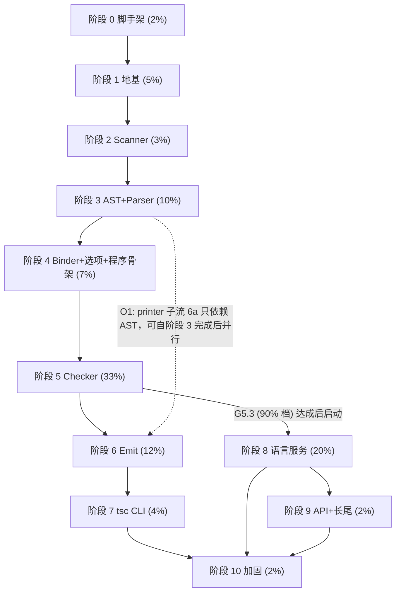

# 09 — 阶段计划（Phases）

| 元信息 | |
|---|---|
| 版本 | v1.1 |
| 日期 | 2026-07-11 |
| 状态 | Draft |
| 主计划 | `~/.claude/plans/precious-riding-hoare.md`（已批准；本文档是其 §三 文档集中的 09 号，内容 = 主计划 §二「分阶段实施与验证门禁」表的全文展开） |
| 上游快照 | `/Users/token/Desktop/code/typescript-go-main`（下文简写 `tsgo/`，`core.Version()` = `"7.1.0-dev"`；所有 file:line 引用以该工作区为准，升级 pin 时按 00-overview.md 漂移处置流程复核） |
| 目标仓库 | `/Users/token/Desktop/code/typescript-csharp` |
| 交叉引用 | 00-overview.md（钉扎/漂移处置）· 01-architecture.md（线程模型/LargeStackExecutor/JSON 字节保真；§10-6 LSP 线程预算 → 本文 G8.2 落位）· 04-codegen.md（生成器族）· 05-conventions.md（惯用法）· 06-module-inventory.md（逐包清单；§13.2 execute 依赖登记 → 本文 §1.4 O2）· 08-testing-strategy.md（夹具/跑批器/fourslash/性能语料；其 §11 两条待澄清由本文 §0.3 裁决）· 10-phase-0-scaffolding.md（阶段 0/1 文件级 WBS）· 11-progress.md（签核表按本文门禁 ID 引用）· 12-risks.md（风险册按本文门禁 ID 标注检测手段） |

---

## 0. 本文范围与读法

### 0.1 定位

本文回答三个问题：**每个阶段何时可以开始（进入条件）、何时算做完（出口门禁）、做什么（工作分解）**。门禁的实现机器（跑批器、夹具格式、diff 算法）在 08-testing-strategy.md；门禁的签核记录在 11-progress.md §6；门禁捕获的风险映射在 12-risks.md。本文只定义**判据与测量命令**。

### 0.2 口径与约定

- **货币**：与 tsgo 输出的逐字节 diff（主计划 §四.1）。各阶段货币依次为 token 流 → AST 转储 → symbol/flow → errors.txt → types/symbols → js/d.ts/map → tsbuildinfo → fourslash。
- **门禁 ID**：每条出口门禁有稳定编号 `G<阶段>.<序号>`（如 G0.1、G5.3）。11-progress.md 签核表与 12-risks.md 检测手段列按此 ID 引用；ID 一经发布**不得复用或改义**，作废门禁标记为「已废止」并保留行。
- **共通门禁约定**：每阶段的 `G<p>.0` 恒为「构建与 analyzer 门」：`dotnet build TypeScript.slnx -c Release` 0 error、AOT/Trim analyzer 0 warning（07-aot-constraints.md 政策）、11-progress.md 包状态表已更新。每阶段最后一条恒为「AOT 复跑门」：对 `dotnet publish /p:PublishAot=true` 产物复跑该阶段全部货币测试（主计划 §四.2；基架见 08 §8）。
- **用例与变体**：conformance 的「用例」指跑批器从测试文件枚举出的顶层测试；带 varyBy 选项的用例展开为配置变体子测试（tsgo/internal/testrunner/compiler_runner.go:159-202，`t.Run(testName, …)` 每配置一个子测试）。**用例通过 = 其全部变体的当期货币全部匹配**。通过率的分母按顶层用例计。
- **命令 cwd**：所有测量命令默认在目标仓库根执行；JIT 轨命令直接给出，AOT 轨由 08 §8.4 的 AotHost 承载。
- 工期只用**相对占比**（主计划 §二，总和 100%）+ 依赖关系表述，不做任何绝对时间承诺。

### 0.3 本文对 08 号文档两条待澄清的裁决（评审员裁定，本文落锤）

1. **fourslash 分母口径**（08 §11 待澄清 → 已裁决）：分母三段**分别计数**——顶层手写 289 个 + `manual/` 210 个 + `gen/` 3,796 个（`gen/` 计数已本机核实：`ls tsgo/internal/fourslash/tests/gen | wc -l` = 3,796），合计 4,295。**`gen/` 段是 50%→90%→99% 分级门禁的主分母**；手写段与 manual 段单列达标线（见 §11.4）。
2. **阶段 2 门禁含 TokenValue 逐一比对**（08 §11 待澄清 → 已裁决）：token 流 diff 的比对元组为 `(kind, pos, end, text)` 四元组，其中 **text 即 scanner 的 TokenValue**（含转义处理后的字符串值、数字 token 的规范化文本），不是源文本切片。dumptool 夹具（08 §2）按此四元组导出。

---

## 1. 全局视图

### 1.1 阶段 DAG



主干串行链 0→1→2→3→4→5→6→7 是关键路径（合计 76%）；阶段 8（20%）是第二长杆，靠与 5 尾部/6/7 重叠吸收；9、10 收尾。

### 1.2 工期占比与关键路径

| 阶段 | 名称 | 占比 | 位于关键路径 | 备注 |
|---|---|---|---|---|
| 0 | 脚手架 | 2% | 是 | |
| 1 | 地基 | 5% | 是 | |
| 2 | Scanner | 3% | 是 | |
| 3 | AST+Parser | 10% | 是 | 同时移植 testrunner+testutil（后续一切门禁的基架） |
| 4 | Binder+选项+程序骨架 | 7% | 是 | |
| 5 | Checker | 33% | 是（主峰） | 分级子门禁 G5.1–G5.5，见 §8 |
| 6 | Emit | 12% | 是 | 6a（printer）可提前并行，见 O1 |
| 7 | tsc CLI | 4% | 是 | 对 format 有跨阶段依赖，见 O2 |
| 8 | 语言服务 | 20% | 否（与 5 尾部/6/7 重叠） | 5 达 90% 档启动 |
| 9 | API+长尾 | 2% | 否 | 排在 8 后（api 构建于项目系统之上，主计划 §二行序） |
| 10 | 加固 | 2% | 收尾汇合点 | 7、8、9 全部完成后进入 |

主计划 §二结论原样保留：阶段 5 主导工期；其前约 27% 的工作全部由 dumptool 差分夹具护航，使 checker 长征的每个 check* 函数都有可执行的判定 oracle。

### 1.3 并行泳道

- **泳道 A（主干）**：0→1→2→3→4→5→6b→7。
- **泳道 B（emit 先遣）**：阶段 3 出口后即可启动 6a（printer + 纯语法 transforms，只依赖 AST 与 scanner；tsgo printer 不引 checker）。
- **泳道 C（语言服务）**：G5.3（errors 货币 90% 档）达成后启动阶段 8；8 的前置切片（checker services 面）在 §8.3 批次 B11 中预留。
- **泳道 D（工具）**：dumptool、conformance-stats、baseline-accept、fourslash 转换器等工具开发不占主干，可随时插队；但其**就绪时点**被写进对应阶段的进入条件。

### 1.4 重叠 DAG 显式登记（评审员裁定必登三项）

| ID | 重叠项 | 内容与依据 | 登记结论 |
|---|---|---|---|
| **O1** | printer 与 checker 部分并行 | printer 只依赖 AST（主计划 §二排程注）。阶段 6 拆为 6a/6b：6a = printer 骨架 + 纯语法 transforms + writer/注释/空白引擎，进入条件仅为阶段 3 出口；6b = 类型指导部分（const enum 内联、declaration transforms、emit resolver 消费面），进入条件为 G5.5 + 阶段 5 批次 B11（emitresolver）完成 | **登记为计划内并行**：6a 与阶段 5 并行推进；6a 产物先以 dumptool 打印夹具（08 §2 扩展族）自检，.js 货币计量待 6b 合流后启动 |
| **O2** | 阶段 7 对 ls/lsutil 与 format 的提前依赖 | Go 侧 execute 直接 import format：tsgo/internal/execute/tsc.go:16（本次抽样实证）；execute 对 ls/lsutil 的引用登记见 06-module-inventory.md §13.2（本次抽样未在 execute 非测试代码中另证到 ls/lsutil import 点，以 06 §13.2 为准，若与源码不符须回改本行——已列 §14 待澄清 #4） | **登记为跨阶段前置**：format 包（4.3k，原属阶段 8 范围）中被 execute 引用的子集、以及 06 §13.2 登记的 ls/lsutil 子集，须在**阶段 7 进入前**完成移植并单测绿；作为阶段 7 进入条件 E7.4 |
| **O3** | fswatch 最小后端是否前移 | tsgo 的 watch 后端抽象在 execute 包内：tsgo/internal/execute/watchmanager/watchbackend.go；tscWatch 基线测试用 mock 后端（tsgo/internal/execute/tsctests/mock_watch_backend.go），不触真实文件系统监视 | **裁定：真实 fswatch 后端（FileSystemWatcher 重写）不前移，留阶段 8**；前移的只有 watchmanager 抽象层 + mock 后端（属阶段 7 tsctests 基架移植的一部分）。阶段 7 的 tscWatch 门禁（G7.1）在 mock 后端上判定；真实后端的 e2e watch 冒烟归阶段 8（G8.6 附带） |

---

## 2. 共通规程

### 2.1 每阶段共通出口门禁

每阶段出口门禁表首行 `G<p>.0`（构建与 analyzer 门）与末行（AOT 复跑门）为共通项，判据统一如下，不在各阶段重复展开：

| 项 | 判据 | 测量命令 |
|---|---|---|
| 构建门 | `dotnet build TypeScript.slnx -c Release` 0 error 0 warning（含 AOT/Trim analyzer，07 号文档全开政策） | `dotnet build TypeScript.slnx -c Release -warnaserror` |
| AOT 复跑门 | 三平台（win-x64/linux-x64/osx-arm64）发布产物复跑该阶段全部货币测试，结果与 JIT 轨全等 | `dotnet publish src/Ts.Cli -c Release /p:PublishAot=true -r <rid>` + 08 §8.4 AotHost 套件 |

### 2.2 签核

每条门禁通过后，在 11-progress.md §6 签核表登记：门禁 ID、通过日期、证据（报告文件路径 / CI run 链接 / 报告 JSON 摘要）、签核会话。门禁定义变更走本文改版（版本号 bump + 11 号登记「门禁定义变更」事件）。

### 2.3 回退 / 重规划通用机制

任一触发器命中时的统一处置流程：
1. 在 12-risks.md 登记事件（关联门禁 ID 与触发器编号）；
2. 冻结当前批次推进，产出根因分析（区分：移植缺陷 / 设计文档缺陷 / 主计划架构决策与源码矛盾）；
3. 设计缺陷 → 修订对应设计文档（02/03/05/07/08）并 bump 版本；架构决策矛盾 → 上升主计划修订，**本文不得自行发明新架构决策**；
4. 修订后在 11-progress.md 登记重规划记录，重开推进。

**通用触发器**（各阶段专属触发器在各节补充）：
- **T-G1 停滞**：当期货币通过率连续两周（以 11 号文档周记为准）无净增长；
- **T-G2 回归**：已签核门禁的货币通过率回落且 48 小时内未定位根因；
- **T-G3 漂移**：上游 pin 升级导致门禁判据失效（走 00-overview.md 漂移处置，本文相关引用行号复核）；
- **T-G4 矛盾**：实现中发现主计划 §一 架构决策与 tsgo 源码不符（先例：主计划 §五对抗验证的 PARTIAL 项）。

---

## 3. 阶段 0 — 脚手架（占比 2%）

### 3.1 范围与工作分解

文件级 WBS 的权威在 10-phase-0-scaffolding.md §1（滚动波详规），此处只列功能簇：

| 工作簇 | 内容 |
|---|---|
| 解决方案骨架 | TypeScript.slnx、Directory.Build.props（net10.0 / Nullable / ImplicitUsings off / InvariantGlobalization / IsAotCompatible+analyzer 全开）、Directory.Packages.props、8 个 csproj、.gitignore、git init（10 号 §0 实况：仓库尚非 git 仓库，须先落 .gitignore） |
| 子模块与 testdata | `_submodules/TypeScript` 钉到与 tsgo 相同 commit；`testdata/baselines/reference/` 同步坐标 A 的 49,321 个 Git 跟踪文件（顶层 15 个子目录：api/astnav/compiler/config/conformance/fourslash/lsp/submodule/submoduleAccepted/submoduleTriaged/tsbuild/tsbuildWatch/tsc/tscWatch/tsoptions）；`testdata/tests/cases/{compiler,conformance}` 本地语料 297 个 .ts；submoduleAccepted.txt（1,426 行）与 submoduleTriaged.txt（87 行）同步 |
| 生成器自举 | tools/generator：generate-csharp-ast.ts（ast.json 副本入仓）→ Ast/*.g.cs ×7；generate-diagnostics.ts → Messages.g.cs（2,154 条）；generate-libs.ts → 108 个 lib.*.d.ts EmbeddedResource |
| 运行时基建 | `Ts.Core.LargeStackExecutor`（64MB 大栈线程，主计划 §一.5「0 号风险」对策）+ 单测 |
| CI | 三平台矩阵：build + analyzer + AOT publish 冒烟 + 测试骨架 |
| 差分测试通道预备 | dumptool 补丁分支骨架（tsgo fork + 补丁集目录 + 再生成脚本入口，08 §2.1）；仓库根 `fixtures/fixtures.lock.json` 初版（08 §2.5） |

### 3.2 进入条件

- E0.1 主计划已批准（已满足）；
- E0.2 plan/ 文档集 00–12 就位（本文档为最后一块）；
- E0.3 .NET SDK 10.0.301 可用（已满足，主计划 Context）。

### 3.3 出口门禁

| ID | 门禁 | 量化判据 | 测量命令 |
|---|---|---|---|
| G0.0 | 构建与 analyzer 门 | §2.1 共通 | §2.1 |
| G0.1 | AOT hello-CLI | 三平台 `dotnet publish /p:PublishAot=true` 成功，产物可执行并打印版本串 `7.1.0-dev`（与 tsgo/internal/core/version.go 精确相等） | `dotnet publish src/Ts.Cli -c Release /p:PublishAot=true -r <rid> && ./src/Ts.Cli/bin/Release/net10.0/<rid>/publish/tscs --version` |
| G0.2 | AST 生成物 | Ast/*.g.cs ×7 生成、入库、编译，AOT/Trim analyzer 0 warning；生成器幂等（重跑无 diff） | `npm run --prefix tools/generator gen:ast && git diff --exit-code src/Ts.Compiler/Ast` |
| G0.3 | 诊断表 | Messages.g.cs 条目数 = 2,154，与子模块 diagnosticMessages.json 逐条 code/text 相等（单测断言） | `dotnet test tests/Ts.Compiler.Tests --filter "FullyQualifiedName~DiagnosticsTable"` |
| G0.4 | lib 资源 | 程序集内嵌 lib.*.d.ts 计数 = 108，逐文件与子模块字节相等（单测断言） | `dotnet test tests/Ts.Compiler.Tests --filter "FullyQualifiedName~BundledLibs"` |
| G0.5 | 子模块与 testdata 钉扎 | submodule commit == tsgo pin；`testdata/baselines/reference` Git 跟踪文件计数 = 49,321，镜像总计数/逻辑字节与 UPSTREAM.lock 相等，且同步脚本逐文件校验无漂移 | `git submodule status` + `bash tools/sync-testdata.sh --verify` |
| G0.6 | LargeStackExecutor | 单测绿：64MB 栈上深递归（≥1e6 帧的人工递归）不炸、串行/并行两实现语义等价 | `dotnet test tests/Ts.Compiler.Tests --filter "FullyQualifiedName~LargeStackExecutor"` |
| G0.7 | dumptool 骨架 + fixtures.lock.json（评审员增补） | dumptool 补丁分支能在 tsgo 上编译并对单文件产出 tokens 族夹具样例；仓库根 `fixtures/fixtures.lock.json` 初版入库（记录夹具族版本/分片 hash 字段骨架，08 §2.5） | tsgo 侧 `go build ./tools/dumptool` + 样例文件 diff 自检 |
| G0.8 | 夹具存储通道定案（评审员增补） | 「Git LFS vs 独立目录直存」二选一已定案并写入 08 §2.5 修订与 00-overview.md；仓库配置（.gitattributes 或同步脚本）落地 | 决议记录 + `git check-attr` 抽查 |
| G0.9 | CI 管线 | 三平台 CI 全绿（pin-and-drift、build-test、aot-smoke 三类 job；后两类为平台矩阵） | CI run 链接登记 11 号 §6 |
| G0.A | AOT 复跑门 | §2.1 共通（本阶段即 G0.1 本身 + AotHost 空壳跑通） | §2.1 |

### 3.4 依赖与并行

无上游阶段。G0.7/G0.8 可与其余项并行；G0.2–G0.4（生成器）依赖 G0.5（子模块，输入来源）。

### 3.5 专属风险（→12 号风险册）

巨型生成文件拖垮 IDE（主计划 §一.1 已用「拆 7 个 .g.cs + 不用源生成器」缓解）；testdata 5 万文件的仓库体积与 clone 时间（G0.8 的存储通道定案就是缓解动作）。

### 3.6 回退 / 重规划触发条件

- 生成器对 ast.json 的三条规则（最派生基/mixin 去重/brand 接口）任何一条在生成物上验证失败 → T-G4 流程，回修 02-ast-design.md；
- 任一平台 AOT publish 无法通过且两周内无解 → 上升主计划（AOT 是根决策）。

---

## 4. 阶段 1 — 地基（占比 5%）

### 4.1 范围与工作分解

主计划 §二行 1；文件级 WBS 在 10 号文档 §2。功能簇与 LOC（已核实）：core 2.7k、collections 0.8k、tspath 1.4k、vfs 3.1k、jsnum 0.6k、stringutil 5.6k、glob、semver。含主计划 §一.6 的结构键缓存/LinkStore/OrderedMap/CopyOnWriteMap 基建与 xxh3 映射（XxHash128）。

### 4.2 进入条件

- E1.1 G0.0–G0.9 全部签核；
- E1.2 06-module-inventory.md 中上述包的「需移植 Go 测试资产」清单已核对。

### 4.3 出口门禁

| ID | 门禁 | 量化判据 | 测量命令 |
|---|---|---|---|
| G1.0 | 构建与 analyzer 门 | §2.1 共通 | §2.1 |
| G1.1 | 移植单测全绿 | 06 号清单登记的上述 8 包全部 Go `*_test.go` 用例逐用例直译并 100% 通过 | `dotnet test tests/Ts.Compiler.Tests --filter "Category=PortedUnit"` |
| G1.2 | jsnum 数字保真 | 100 万随机 double 夹具：数字→字符串 / ToInt32 / ToUint32 / Number 解析四路逐位相等（主计划 §二行 1 括注的 ES6 版式层判据；jsnum string_test.go 的边界表——{1e21,"1e+21"}、{1e20,"1000…000"}、-0→"0" 等——作为钉死用例全绿） | `dotnet test tests/Ts.Compiler.Tests --filter "FullyQualifiedName~JsNumFixture"`（夹具由 dumptool jsnum 族生成，08 §2） |
| G1.3 | xxh3 保真 | 固定测试向量过：`xxh3_128("export const a = 10;") = 3a1e9965f8602302ee6ae53756eac8be`（UTF-8 字节、大端 16 字节、小写 hex，主计划 §一.6） | `dotnet test tests/Ts.Compiler.Tests --filter "FullyQualifiedName~Xxh3Vector"` |
| G1.A | AOT 复跑门 | §2.1 共通 | §2.1 |

### 4.4 依赖与并行

依赖阶段 0 全量。包间可并行（core/collections 先行，vfs/stringutil 随后）；dumptool 各夹具族的 Go 侧实现（泳道 D）应在本阶段完成 tokens 族，保证阶段 2 进入条件。

### 4.5 专属风险

浮点格式保真（12 号风险册「浮点格式」条）；InvariantGlobalization 下的 ordinal 语义审计（07 号）。

### 4.6 回退 / 重规划触发条件

- G1.2 夹具失配率在修复一轮后仍 >0.01%（100 例/百万）→ 判定 ES6 版式层设计缺陷，回修 05-conventions.md 数字条目并重做；
- 通用触发器 T-G1–T-G4。

---

## 5. 阶段 2 — Scanner（占比 3%）

### 5.1 范围与工作分解

scanner 4.3k LOC；UTF-16 偏移原生化、删 PositionMap（主计划 §一.6）。功能簇：主扫描循环 / 标识符与 Unicode 表（RVA 静态数据，04 号）/ 数字与字符串字面量（依赖 jsnum G1.2）/ 模板与正则 rescan / JSX 模式 / 注释与 shebang / TokenFlags。

### 5.2 进入条件

- E2.1 G1.0–G1.3 签核；
- E2.2 dumptool tokens 族夹具已对**全语料**（约 5 万语料文件：子模块 tests/cases 全集 + 本地 297 + lib 文件；口径见 08 §2）生成完毕并入 fixtures.lock.json。

### 5.3 出口门禁

| ID | 门禁 | 量化判据 | 测量命令 |
|---|---|---|---|
| G2.0 | 构建与 analyzer 门 | §2.1 共通 | §2.1 |
| G2.1 | token 流 diff 100% | 全语料逐文件 token 流与夹具 100% 匹配；比对元组 `(kind, pos, end, text)`，**text = TokenValue**（本文 §0.3 裁决 #2：含转义解码后的字符串值与数字规范化文本） | `dotnet test tests/Ts.Compiler.Tests --filter "Category=Differential&Family=tokens"` + 08 §3 框架的失配清单为空 |
| G2.2 | rescan 专项 | 正则 rescan / 模板中缀 rescan / JSX 文本模式 / `>>` 拆分等 rescan 路径的专项夹具子集（dumptool tokens 族的 rescan 标注切片）100% | 同上 `--filter "…&Slice=rescan"` |
| G2.A | AOT 复跑门 | §2.1 共通 | §2.1 |

### 5.4 依赖与并行

依赖阶段 1（jsnum、stringutil、core）。无下游可并行项（阶段 3 强依赖本阶段）。

### 5.5 专属风险

UTF-16 偏移语义（12 号「基线位置语义」条——本阶段是第一道检验）；星面字符（surrogate pair）处的 pos/end。

### 5.6 回退 / 重规划触发条件

- 若 TokenValue 比对暴露 dumptool 导出口径问题（Go 侧 rune / C# 侧 UTF-16 差异）→ 回修 08 §2 夹具规格而非 scanner 本体（先裁口径再改代码）；
- 通用触发器。

---

## 6. 阶段 3 — AST + Parser（占比 10%）

### 6.1 范围与工作分解

| 工作簇 | 内容与规模 |
|---|---|
| AST 本体 | ast 20.8k（半生成：Ast/*.g.cs 已在 G0.2 产出；手写部分为 Node 基础设施、NodeList、工厂钩子、访问器语义，02 号文档权威） |
| Parser | parser 9.1k：递归下降主体 / 增量解析入口 / JSDoc 解析 / 上下文标志（ContextFlags）/ 错误恢复 |
| astnav | 0.8k（token 导航，阶段 8 的地基但此时一并移植，tsgo 侧有独立基线目录 reference/astnav） |
| 测试基架 | **testrunner 889 LOC + testutil 5,730 LOC 同步移植**（08 §1.3 布局）：TestCaseParser、BaselineRunner、patience diff、tsbaseline 写出器骨架——这是阶段 4–8 一切基线门禁的机器，必须在本阶段出口前就绪 |

### 6.2 进入条件

- E3.1 G2.0–G2.2 签核；
- E3.2 dumptool ast 族 + 解析诊断族夹具全语料生成完毕。

### 6.3 出口门禁

| ID | 门禁 | 量化判据 | 测量命令 |
|---|---|---|---|
| G3.0 | 构建与 analyzer 门 | §2.1 共通 | §2.1 |
| G3.1 | 零崩溃解析 | 全语料（约 5 万文件）解析零异常逃逸、零栈溢出（LargeStackExecutor 上跑，金丝雀深嵌套语料含在内） | 跑批器 crash 计数 = 0（08 §3 报告字段） |
| G3.2 | AST 结构转储 diff 100% | 全语料 AST 结构转储（kind 树 + pos/end + 承重字段，08 §2 ast 族格式）100% 匹配 | `dotnet test tests/Ts.Compiler.Tests --filter "Category=Differential&Family=ast"` |
| G3.3 | 解析诊断 100% | 解析期诊断 `(code, pos, len)` 三元组序列逐文件 100% 匹配 | 同上 `--filter "…&Family=parsediag"` |
| G3.4 | 测试基架自检 | testrunner/testutil 移植完成：patience diff 对 Go 实现的差分自检夹具全绿；TestCaseParser 对全语料 @option 解析与 Go 侧导出一致 | `dotnet test tests/Ts.TestUtil.Tests`（基架自身的单测） |
| G3.A | AOT 复跑门 | §2.1 共通 | §2.1 |

### 6.4 依赖与并行

依赖阶段 2。**本阶段出口即解锁泳道 B（6a printer 先遣）**——printer 只依赖 AST（O1）。astnav 与测试基架两簇可与 parser 主体并行。

### 6.5 专属风险

栈深度（parser 递归极深，0 号风险首个实战检验）；ast.json 生成物与手写 parser 的字段契约错位；JSDoc 解析的 reparse 语义。

### 6.6 回退 / 重规划触发条件

- G3.2 暴露生成器规则缺陷（如 mixin 字段缺失）→ T-G4，回修 02 号 + 重新生成，**不允许在手写代码里绕过生成物缺陷**；
- G3.1 栈溢出在 64MB 栈上仍复现 → 0 号风险升级，上升主计划（可能需 checker 前重新评估迭代化改造范围）；
- 通用触发器。

---

## 7. 阶段 4 — Binder + 选项 + 程序骨架（占比 7%）

### 7.1 范围与工作分解

| 工作簇 | 内容与规模 |
|---|---|
| Binder | binder 3.6k：符号创建与合并 / 作用域链（LocalsContainer）/ flow 图构建 / strict 模式标志 |
| tsoptions | 6.1k：命令行与 tsconfig 解析；反射 merge/遍历（declscompiler.go:1203、showconfig.go:169）→ 生成的 ~150 字段 per-field switch（04 号生成器族） |
| 模块解析器 | 2.8k：node16/nodenext/bundler 等模式全量 |
| 程序骨架 | fileloader/Program 子集：文件图构建、lib 注入（bundled:/// VFS）、checker 池骨架（4-checker 静态钉扎 index%N，主计划 §一.2） |

### 7.2 进入条件

- E4.1 G3.0–G3.4 签核；
- E4.2 dumptool symbol/flow 族夹具全语料生成完毕（位置已预转 UTF-16，主计划 §二导语）。

### 7.3 出口门禁

| ID | 门禁 | 量化判据 | 测量命令 |
|---|---|---|---|
| G4.0 | 构建与 analyzer 门 | §2.1 共通 | §2.1 |
| G4.1 | symbol 转储 100% | 全语料 symbol 表转储（名称/flags/声明列表/合并结果，08 §2 symbol 族）100% 匹配 | `dotnet test tests/Ts.Compiler.Tests --filter "Category=Differential&Family=symbols"` |
| G4.2 | flow 转储 100% | flow 图转储（节点 kind/前驱/标签结构）100% 匹配 | 同上 `--filter "…&Family=flow"` |
| G4.3 | tsoptions 基线 | `testdata/baselines/reference/{tsoptions,config}` 两目录对应基线测试 100% 字节匹配（tsgo 侧这两个目录已实测存在） | `dotnet test tests/Ts.Conformance.Tests --filter "Suite=tsoptions|Suite=config"` |
| G4.4 | 模块解析 trace | 模块解析 trace 夹具（dumptool 导出，含 node16/nodenext/bundler 分模式切片）100% 匹配 | `--filter "…&Family=moduleres"` |
| G4.A | AOT 复跑门 | §2.1 共通 | §2.1 |

### 7.4 依赖与并行

依赖阶段 3。四个工作簇中 tsoptions 与 binder 互不依赖可并行；程序骨架依赖三者合流。本阶段出口后阶段 5 全面开工，同时泳道 B（6a）持续推进。

### 7.5 专属风险

tsoptions 反射消除的字段遗漏（G4.3 捕获）；map 迭代序首个大规模移植审计（05 号审计规则强制执行，12 号「Dictionary 序陷阱」条）。

### 7.6 回退 / 重规划触发条件

- per-field switch 生成器与 tsoptions 结构漂移 → 回修 04 号生成器而非手改生成物；
- 通用触发器。

---

## 8. 阶段 5 — Checker 专章（占比 33%，主峰）

### 8.1 范围与证据地图

checker 包 19 个文件共 59,975 行（含少量 `_test.go`；本机 `wc -l tsgo/internal/checker/*.go` 实测），另加 evaluator 168 行（tsgo/internal/evaluator/evaluator.go）与 pseudochecker 1,126 行（tsgo/internal/pseudochecker/{checker,lookup,type}.go = 21+729+376），合计 ≈61k，与主计划 §二行 5 口径一致。文件分布（实测行数）：

| 文件 | LOC | 功能域 | 归属批次（§8.3） |
|---|---|---|---|
| checker.go | 31,926 | 主体：1,338 个 `func (c *Checker)` 方法（实测 grep 计数）；方法名前缀直方图：get×515、check×239、is×157、resolve×38、create×38、report×27、instantiate×23、has×23、add×22、mark×16 | B0–B7、B9 主战场 |
| relater.go | 5,006 | 类型关系判定（isTypeRelatedTo:170、checkTypeRelatedTo:352、checkTypeRelatedToEx:359、checkTypeRelatedToAndOptionallyElaborate:430、`Relater.isRelatedToWorker`:2592） | B3 |
| nodebuilderimpl.go | 3,585 | 类型→AST 重建（typeToString 与 declaration emit 的共同地基） | B0（最小闭包）+ B11（全量） |
| flow.go | 2,734 | 控制流窄化（getFlowTypeOfReference:77/81、narrowType:377） | B7 |
| grammarchecks.go | 2,202 | 59 个 `checkGrammar*` 方法（实测 grep 计数；checkGrammarSourceFile:2042） | B10 |
| utilities.go | 1,844 | 跨批次工具 | 随用随迁 |
| inference.go | 1,651 | 类型推断（inferTypes:54、inferFromTypes:66） | B6 |
| jsx.go | 1,482 | JSX（checkJsxElement:71、checkJsxElementDeferred:76、checkJsxExpression:88、checkJsxSelfClosingElement:100/105） | B8 |
| types.go | 1,459 | 24 个 Type struct（03 号权威；手写移植不代生成，主计划 §一.2） | B1 |
| emitresolver.go | 1,322 | 声明发射 resolver | B11 |
| services.go | 1,140 | 语言服务查询面 | B11 尾（可滑入阶段 8） |
| nodecopy.go | 900 | 节点深拷贝（declaration emit 用） | B11 |
| symbolaccessibility.go | 876 | 符号可达性（declaration emit 用） | B11 |
| pseudotypenodebuilder.go | 765 | 伪类型节点构建 | B11 |
| nodebuilder_hover.go | 597 | hover 展示专用 | B11 尾（可滑入阶段 8） |
| printer.go | 486 | checker 侧类型打印 | B0 |
| tracer.go | 366 | tracing（非承重，EventSource 版可延至阶段 9） | 阶段 9 |
| exports.go | 359 | 导出解析 | B2 |
| mapper.go | 315 | TypeMapper | B1 |

**编排脊柱**（实测锚点）：`checkSourceFile`（checker.go:2182）依次执行 checkGrammarSourceFile（:2191）→ checkSourceElements(Statements)（:2193）→ checkDeferredNodes（:2194）→ 外部模块导出检查与 unused 登记（:2195-2201）→ 延迟诊断固化（:2203）。`checkSourceElementWorker`（checker.go:2242-2377）是语句/声明/类型节点分派的 switch，**59 个 case 臂**；`checkDeferredNode`（checker.go:2491）是延迟检查 switch，11 个 case 臂（call/new/taggedTemplate/decorator/jsxOpening、function/arrow/method、accessors、classExpression、typeParameter、jsxSelfClosing、jsxElement、assertion、void、binary）。

### 8.2 进入条件

- E5.1 G4.0–G4.4 签核；
- E5.2 conformance 跑批器（08 §4）+ 计量工具 tools/conformance-stats（§8.6）+ baseline-accept 工具（08 §4.8）就绪并自检通过；
- E5.3 分母钉死：子模块检出后执行 §8.5 分母命令，将精确用例数写入 11-progress.md §4（当前待澄清 #1）。

### 8.3 移植批次

**批次纪律**：批次 = 主移植焦点，非严格串行墙——每批开工时允许对后续批次留桩（桩统一 `throw new NotImplementedException("B<n>")` 或返回 `anyType`，禁止静默错值）；每批收口跑一轮全量 conformance 计量并登记 11 号。主计划 §二行 5 的依赖脊柱（types→构造/驻留→relations→实例化/推断→窄化/flow→check* 长尾）体现为下表的「依赖」列：B3（relations）与 B6（实例化/推断）是 B4/B5（check* 长尾）的语义地基，B4/B5 首轮以「非泛型、无窄化路径」用例为收割目标，B6/B7 合流后二轮收割。

| 批次 | 名称 | 内容（文件/函数簇，锚点见 §8.1） | 依赖 | 预期解锁的测试族（Strada tests/cases 目录名标识；精确清单待澄清 #2） |
|---|---|---|---|---|
| **B0** | 类型显示最小闭包 | checker/printer.go 全量 + nodebuilderimpl.go 中 typeToString 所需最小路径 + 诊断构造/去重/排序管线。理由：errors.txt 货币的消息文本内嵌类型显示串（`Type 'X' is not assignable…`），没有 B0 一切 errors 比对无从谈起 | B1 部分（并行推进，接口先行） | 无独立解锁；是全部后续批次的显示层 |
| **B1** | 类型构造与驻留 | types.go、mapper.go；`getTypeFromTypeNode`（checker.go:22713）簇；字面量/union/intersection 驻留表；`newObjectType` 的 ObjectFlags 优先序（主计划 §一.2 承重，checker.go:24971）；结构键缓存接入（03 号签名表） | 阶段 4 出口 | conformance/types/primitives、types/literal、types/union（errors 为空的「干净用例」开始整用例通过） |
| **B2** | 符号解析 | `getSymbolOfDeclaration`（:14316）、`resolveEntityName`（:15685）、`resolveAlias`（:16179）、`getTypeOfSymbol`（:16406）簇；exports.go；import/export 语义检查的解析半边 | B1 | conformance/internalModules、externalModules、moduleResolution 的符号类 errors；compiler/ 下 import* 族 |
| **B3** | 关系判定 | relater.go 全文件；关系缓存（per-checker，主计划 §一.2）；elaboration 链（checkTypeRelatedToAndOptionallyElaborate:430） | B1、B0（错误消息） | types/typeRelationships 全族；assignability 类 errors——errors.txt 货币的最大单一来源 |
| **B4** | 表达式检查 | `checkExpression`（:7530）簇：`checkCallExpression`（:8298，含重载解析/泛型调用留桩）、`checkBinaryExpression`（:12293）、对象/数组字面量、属性访问、模板、`checkDeferredNode`（:2491）编排 | B2、B3 | expressions/ 全族、functions/ 调用类；compiler/ 大量混合用例首轮收割 |
| **B5** | 语句与声明检查 | `checkSourceElementWorker` 59 case（:2242-2377）逐臂补实：`checkVariableDeclaration`（:5760）、class/interface/enum/module/import-export 声明检查；`checkSourceFile` 编排（:2182）与 unused 检查；evaluator（tsgo/internal/evaluator/evaluator.go，enum/const 求值） | B4 | statements/ 全族、classes/、interfaces/、enums/、ambient/；25% 档主推手 |
| **B6** | 泛型实例化与推断 | `instantiateType`（:22005）簇、inference.go 全文件（inferTypes:54、inferFromTypes:66）、条件类型/映射类型求值、上下文类型（contextual typing）、B4 留桩的泛型调用解析回填 | B3、B4 | types/typeParameters、types/conditional、types/mapped、generics 类 compiler 用例；60% 档主推手 |
| **B7** | 控制流窄化 | flow.go 全文件（getFlowTypeOfReference:77/81、narrowType:377）、`getNarrowedTypeOfSymbol`（:13655）、可辨识联合、断言函数 | B6 | controlFlow/、expressions/typeGuards；60→90 档过渡推手 |
| **B8** | JSX | jsx.go 全文件（checkJsxElement:71 等 5 个入口）+ checkDeferredNode 的 JSX 臂 | B6（JSX 泛型组件） | jsx/ 全族（.tsx 用例） |
| **B9** | JSDoc 与 JS 语义 | checkSourceElementWorker 的 EagerJSDoc 前奏（:2243-2250）与 KindJSDoc* 臂（:2375-2376）、`checkJSDocComments` 簇、salsa/JS 检查（KindJSTypeAliasDeclaration/KindJSImportDeclaration 臂，:2353/:2361） | B5 | jsdoc/、salsa/（allowJs/checkJs 用例）；90% 档收尾推手 |
| **B10** | grammar checks | grammarchecks.go 全文件（59 个 checkGrammar*；checkGrammarSourceFile:2042 在 checkSourceFile 第一步被调，:2191——移植期以 no-op 桩占位，本批回填） | B5（挂点已在） | parser/ 族的 checker 侧 grammar errors；大量用例从「差一条 grammar 诊断」翻绿，90→99.5 档推手 |
| **B11** | 声明发射 resolver 与长尾 | emitresolver.go、nodebuilderimpl.go 剩余全量、pseudotypenodebuilder.go + pseudochecker（1,126 行）、nodecopy.go、symbolaccessibility.go；services.go 与 nodebuilder_hover.go 可滑入阶段 8 前置 | B6 | 对 errors 货币仅 isolatedDeclarations 等小族；主要为 G5.6（.types/.symbols 100%）与阶段 6b（d.ts 发射）解锁 |

### 8.4 分级子门禁（G5.1–G5.5 判据定义）

**分母**：`_submodules/TypeScript/tests/cases/{compiler,conformance}` 全集的顶层用例数（跑批器枚举口径 = tsgo/internal/testrunner/compiler_runner.go:63-65 的两个 basePath：子模块 suite + 本地 `testdata/tests/cases` suite；本地 297 个用例计入分母）。配置变体不单独计入分母（§0.2 口径：用例通过 = 全部变体通过）。精确分母值在 E5.3 钉死（待澄清 #1）。

**「用例通过」判据（errors 货币）**：该用例全部变体的 `.errors.txt` 基线与参考**逐字节相等**——含「两侧均无 errors 基线」的 NoContent 语义（tsgo/internal/testutil/baseline/baseline.go 的 NoContent 处理，:95 一带）。参考基线的解析顺序按 08 §4 移植的三层机制：tsgo 自有基线 `testdata/baselines/reference/submodule/<suite>/`（本机实测 compiler 21,874 个文件 / conformance 22,815 个文件），与 Strada 参考的偏差按 submoduleAccepted.txt（1,426 行）/ submoduleTriaged.txt（87 行）名单分类（baseline.go:57-76、:100-105）。**注意分级档（25/60/90/99.5）按「用例数占比」计，末档 100% 才要求全量字节级零 diff。**

| ID | 档位 | 判据 | 附加条件 | 触发动作 |
|---|---|---|---|---|
| G5.1 | **L25** | errors 货币通过用例 ≥ 分母 × 25% | **crash = 0**：全分母用例零异常逃逸/零栈溢出（crash 与 diff-fail 分开计数，crash 是硬零）；B0–B5 批次全部收口 | 复盘批次 B0–B5 桩清单，制定 B6/B7 回填顺序 |
| G5.2 | **L60** | ≥ 60% | 确定性抽检：随机 1,000 用例在 `--singleThreaded` 与 4-checker 并行两模式下输出全等（跑批器开关维度，08 §4.2）；B6/B7 收口 | 启动 6b 准备（emit resolver 接口冻结评审） |
| G5.3 | **L90** | ≥ 90% | B8/B9/B10 收口；4-checker 并行抽检扩大到 10,000 用例 | **阶段 8 启动闸**（泳道 C 开工）；性能烟测一次（无门禁，登记趋势） |
| G5.4 | **L99.5** | ≥ 99.5% | 剩余失败用例（分母 × 0.5% 量级）**逐用例 triage 表**入 11 号 §5：每条标注根因分类（消息文本/位置/诊断排序/类型显示/语义）与责任批次；`.types`/`.symbols` 货币开始计量并登记基线通过率 | 长尾冲刺排期；每周 triage 表清零复盘 |
| G5.5 | **L100** | errors 货币 100% **字节匹配**（零 diff、零 crash、零 accepted 例外新增） | — | 进入 G5.6 |
| G5.6 | types/symbols | `.types` 与 `.symbols` 基线 100% 字节匹配（B11 的 nodebuilder 全量为前提；Decl(行,列) 为 UTF-16 口径，主计划 §一.6 已核验） | UTF 垫片（08 §5）已生效 | 进入 G5.7 |
| G5.7 | 并行终检 | 开 4-checker 并行跑全量 conformance，输出与单 checker 模式**全等**（主计划 §二行 5 终检 + §四.3） | 文件钉扎 index%N 语义与 tsgo 一致 | 阶段 5 签核前置 |
| G5.8 | AOT 复跑门 | §2.1 共通（全量 conformance 在 AOT 产物上复跑，errors/types/symbols 三货币全等） | — | 阶段 5 签核 |

（G5.0 构建与 analyzer 门贯穿，略。）

### 8.5 测量命令与工具契约

分母钉死（一次性，E5.3）：

```bash
git submodule update --init _submodules/TypeScript
find _submodules/TypeScript/tests/cases/compiler \
     _submodules/TypeScript/tests/cases/conformance \
     -name "*.ts" -o -name "*.tsx" | wc -l          # + 本地 297 → 写入 11 号 §4
```

每轮计量（G5.1–G5.6 共用）：

```bash
dotnet test tests/Ts.Conformance.Tests -c Release            # 跑批，写 testdata/baselines/local/
dotnet run --project tools/conformance-stats -- \
  --local testdata/baselines/local --reference testdata/baselines/reference \
  --currency errors --out artifacts/conformance-report.json
```

`tools/conformance-stats`（阶段 5 进入前建成，E5.2）报告契约：`{suite, denominator, passed, rate, crashed, newAcceptedCount, topRegressions[], failuresTsv}`。`rate` 即门禁判据字段；`failuresTsv` 供 G5.4 triage 表直接导入。确定性抽检：跑批器 `--singleThreaded` 开关两轮跑 + `diff -r` 两个 local 目录。

### 8.6 依赖与并行

依赖阶段 4 全量。批次内并行：B1/B2 可双线；B3 收口前 B4 只能做非关系依赖的臂。与泳道 B（6a printer）全程并行；G5.3 后与阶段 8 并行；B11 与 G5.4 长尾冲刺可并行。

### 8.7 专属风险（→12 号）

- **栈深度**（0 号风险主战场：relater/instantiate/inference 相互递归）——G5.1 的 crash=0 附加条件即其检测器；
- **map 迭代序**（union 成员显示序、诊断排序）——05 号审计规则 + errors 字节比对捕获；
- **类型显示串细节**（truncation、别名保留）——B0 前置即为此风险减震；
- **关系缓存跨 checker 泄漏**（Type.checker 反向指针纪律，主计划 §一.2）——G5.7 捕获；
- 诊断去重/排序的比较器语义（Go sort 稳定性 vs .NET）——errors 字节比对捕获。

### 8.8 回退 / 重规划触发条件

- **通过率停滞两周**（T-G1 在本阶段的具体化）：当期档位通过率连续两周净增长 <0.5 个百分点 → 冻结新批次，全员转 triage 表根因分析；若根因指向 Type 层次/缓存键设计 → T-G4 回修 03-checker-design.md；
- 某单批次收口后计量**未达该批次预期解锁族的 50%** → 批次划分失真，重排 §8.3 表（本文改版）；
- G5.7 并行终检失败且根因为共享可变状态 → 上升主计划（并发模型是 §一.2 根决策）；
- G5.4 的 triage 表中「无法归因」项超过剩余失败的 20% → 暂停冲刺，扩建 dumptool 定向夹具（type/relations 中间态导出）再战。

---

## 9. 阶段 6 — Emit（占比 12%）

### 9.1 范围与工作分解

printer 11.4k、transformers 24.3k、sourcemap 1.0k（主计划 §二行 6）。按 O1 拆两个子流：

| 子流 | 内容 | 进入条件 |
|---|---|---|
| **6a（先遣，与阶段 5 并行）** | printer 主体（writer、注释/空白/括号引擎）、纯语法 transforms（ES 降级中不依赖类型的部分、模块包装骨架）、sourcemap 生成器 | 阶段 3 出口（G3.x 全签核） |
| **6b（合流）** | 类型指导 transforms：const enum 内联（依赖 evaluator/checker）、declaration transforms（依赖 B11 emit resolver）、模块 transforms 的 resolver 消费面 | G5.5 + B11 收口 |

### 9.2 进入条件

- E6a.1 G3.0–G3.4 签核（6a）；
- E6b.1 G5.5 签核且 B11 收口（6b）；
- E6.2 dumptool 打印夹具族（6a 自检用，08 §2 扩展）就绪。

### 9.3 出口门禁

| ID | 门禁 | 量化判据 | 测量命令 |
|---|---|---|---|
| G6.0 | 构建与 analyzer 门 | §2.1 共通 | §2.1 |
| G6.1 | `.js` 100% | conformance 全量 `.js` 基线 100% 字节匹配（跑批器 output 子跑，对应 tsgo/internal/testrunner/compiler_runner.go:409） | `dotnet run --project tools/conformance-stats -- --currency js …` |
| G6.2 | `.d.ts` 100% | 全量 `.d.ts` 基线 100% 字节匹配（isolatedDeclarations 族含在内） | 同上 `--currency dts` |
| G6.3 | `.js.map` + `.sourcemap.txt` 100% | 全量 sourcemap 基线 100% 字节匹配（compiler_runner.go:436 sourcemap 子跑；续行标记 UTF-8 字节长垫片已生效，主计划 §一.6 垫片 2） | 同上 `--currency map` |
| G6.4 | 并行终检 | emit 在 4-checker 并行与单线程模式下输出全等 | 08 §4.2 开关两轮 + diff |
| G6.A | AOT 复跑门 | §2.1 共通 | §2.1 |

### 9.4 依赖与并行

6a 与阶段 5 并行（O1 登记）；6b 依赖 G5.5。阶段 7 依赖本阶段全量出口。与阶段 8 并行（阶段 8 不依赖 emit 门禁，但 ls 的部分基线间接消费 printer——顺序上 6a 早已就位，无冲突）。

### 9.5 专属风险

注释/空白保真（printer 的 trivia 决策树）；transformers 与 checker 的耦合超预期（const enum、decorator 元数据）；sourcemap 列语义（UTF-16 vs 字节，垫片 2 承重）。

### 9.6 回退 / 重规划触发条件

- `.js` 通过率停滞两周（T-G1 具体化）→ 按 transform 分组归因（跑批器带 @module/@target 分组统计），单 transform 重写；
- 6b 发现 emit resolver 接口不足以支撑 declaration transform → 回修 B11 范围（阶段 5 补课），在 11 号登记跨阶段回补事件；
- 通用触发器。

---

## 10. 阶段 7 — tsc CLI（占比 4%）

### 10.1 范围与工作分解

execute 9.3k（主计划 §二行 7）：

| 工作簇 | 内容（tsgo 侧实测布局：internal/execute/{tsc.go, watcher.go, build/, incremental/, tsc/, tsctests/, watchmanager/}） |
|---|---|
| CLI 主体 | tsc.go 直译（含 O2 登记的 format 依赖：tsgo/internal/execute/tsc.go:16 import internal/format）；命令行三路复用（默认 tsc / --lsp / --api，主计划 §一.3） |
| watch | watcher.go + watchmanager/（watchbackend.go 抽象层 + tsctests/mock_watch_backend.go；O3 裁定：真实后端留阶段 8） |
| --build | build/（编排 DAG、项目引用拓扑） |
| incremental | incremental/ 全目录（实测：snapshot.go、buildInfo.go、snapshottobuildinfo.go、buildinfotosnapshot.go、affectedfileshandler.go、emitfileshandler.go、program.go、programtosnapshot.go、referencemap.go、host.go、incremental.go）；.tsbuildinfo 字节保真按主计划 §一.5（UnsafeRelaxedJsonEscaping / 键序=struct 声明序 / omitzero / 7 种多态形状 / version 精确串）与 §一.6（ComputeHash 承重：UTF-8 字节 XXH3-128 小写 hex） |
| 测试基架 | tsctests/ 移植：runner.go、fs.go、sys.go、readablebuildinfo.go（readable 基线写出器）、mock_watch_backend.go |

### 10.2 进入条件

- E7.1 G6.0–G6.4 签核；
- E7.2 G5.5–G5.8 签核；
- E7.3 tsctests 基架移植完成自检；
- E7.4（O2）：format 中被 execute 引用的子集 + 06 §13.2 登记的 ls/lsutil 子集移植完毕、单测绿。

### 10.3 出口门禁

| ID | 门禁 | 量化判据 | 测量命令 |
|---|---|---|---|
| G7.0 | 构建与 analyzer 门 | §2.1 共通 | §2.1 |
| G7.1 | tsc/tscWatch 基线 | `testdata/baselines/reference/{tsc,tscWatch}` 全量基线 100% 字节匹配（tscWatch 在 mock 后端上判定，O3） | `dotnet test tests/Ts.Conformance.Tests --filter "Suite=tsc|Suite=tscWatch"` |
| G7.2 | tsbuild/tsbuildWatch 基线 | `reference/{tsbuild,tsbuildWatch}` 全量基线 100% 字节匹配（含 readable buildinfo 基线，写出器 = tsctests/readablebuildinfo.go 的移植；readable-baseline 的 2 空格缩进 + size=紧凑文本字节长，主计划 §一.5） | 同上 `--filter "Suite=tsbuild|Suite=tsbuildWatch"` |
| G7.3 | .tsbuildinfo 字节等价 | 两层判定：(a) 上述基线内嵌的 buildinfo 内容逐字节；(b) e2e——对真实项目分别用 tsgo 与 Ts.Cli 跑 `--build`，产出的 .tsbuildinfo 文件 `cmp` 逐字节相等（version 字段 = "7.1.0-dev" 精确串；signature/version 哈希 = UTF-8 字节 XXH3-128 小写 hex，主计划 §一.6 固定向量已在 G1.3 钉死） | `node tools/e2e-compare/run.mjs --mode build --artifact tsbuildinfo`（08 §8.5 工具） |
| G7.4 | 增量 = 全量输出等价 | **测法直译 tsgo/internal/execute/tsctests/runner.go:90-153**：每个 tsc 测试场景带 edits 序列（tscEdit，runner.go:18-21）；每步 edit 后 (a) 增量系统原地重建；(b) 另起全新 sys 重放 edits[0..i] 做非增量全量构建（runner.go:116-120）；两者全部输出文件 diff，**豁免 `.tsbuildinfo` 与 `.readable.baseline.txt`**（runner.go:152-153，因增量与全量的 buildinfo 本就允许不同）；任何非预期 diff 视为失败，除非测试显式登记 expectedDiff 解释文本；解释存在但 diff 消失同样失败（runner.go:132-136 的双向纪律，防解释腐化）。门禁 = 全部移植场景零 unexpected diff | `dotnet test tests/Ts.Conformance.Tests --filter "Suite=tscEdits"` |
| G7.5 | AOT e2e 全等 | 发布 AOT 二进制编译真实大项目，全部输出（js/d.ts/map/tsbuildinfo/诊断流）与 tsgo 逐字节全等；语料 = **08 号已定口径：TypeScript 子模块 src/compiler 自举编译 + typescript-eslint 钉扎 tarball**（08 §9，本文不另立语料） | `node tools/e2e-compare/run.mjs --binary artifacts/aot/tsgo --corpus all` |
| G7.6 | 性能门禁 | 同语料下 AOT 二进制 wall-clock ≤ 2× tsgo（主计划 §二行 7；测三次取中位数；语料同 G7.5） | e2e-compare 的 `--bench` 模式报告 |
| G7.A | AOT 复跑门 | §2.1 共通（G7.5 已覆盖大部分，此处补全量 conformance AOT 复跑） | §2.1 |

### 10.4 依赖与并行

依赖阶段 5、6 全量出口 + E7.4 跨阶段前置（O2）。与阶段 8 并行（共享 format/lsutil 子集的移植成果，避免重复劳动：11 号包状态表按包记账即可防冲突）。

### 10.5 专属风险

JSON 字节保真族（12 号：转义/键序/omitzero/多态形状——G7.2/G7.3 捕获）；watch 时序语义在 mock 后端与真实后端间的偏差（O3 已把真实后端风险推到阶段 8）；--build 的项目图拓扑序依赖 map 迭代序审计。

### 10.6 回退 / 重规划触发条件

- G7.4 出现成簇 unexpected diff 且根因在 incremental 快照哈希 → 回查 G1.3 向量与 snapshot.go:32 移植（主计划 §一.6 承重点）；
- G7.6 性能 >2× 且剖析显示热点为 GC（arena 删除决策的代价）→ 不在本阶段死磕，登记 12 号，移交阶段 10（ServerGC 调优）；若阶段 10 仍无法达标 → 上升主计划；
- 通用触发器。

---

## 11. 阶段 8 — 语言服务（占比 20%）

### 11.1 范围与工作分解

ls 38.9k、format 4.3k（扣除 O2 已前移子集）、lsp 21k（Protocol.g.cs 由 metaModel.json 生成，04 号）、project 11k、fswatch（FileSystemWatcher 重写，O3 裁定的真实后端在此落地）、jsonrpc（主计划 §二行 8）。工作分解按消费面分四簇：ls 查询引擎（含 checker 侧 services.go/nodebuilder_hover.go 的收尾，§8.3 B11 尾）、LSP 线缆层（协议/jsonrpc/生命周期）、project 系统（配置继承/项目图/文件监视消费）、format 引擎剩余。

### 11.2 进入条件

- E8.1 G5.3（L90 档）签核——**启动闸**（主计划 §二排程：8 在 5 达 ~90% 后启动）；
- E8.2 fourslash 转换管线就绪：convertFourslash.mts 等价工具 + `gen/` 用例生成 + 四张名单（failingTests/manualTests/unparsedTests/crashingTests）同步（08 §7）；
- E8.3 阶段 8 的**完整签核**另需 G5.5–G5.8 与 G6.x 全签核（行为对齐以 checker/emit 定稿为前提；50% 档不受此限）。

### 11.3 fourslash 分级机制（failingTests.txt 直译）

tsgo 侧机制（实测锚点）：
- `internal/fourslash/tests/gen/` 生成用例 3,796 个（本机 `ls | wc -l`）；名单文件 `internal/fourslash/_scripts/`：failingTests.txt 459 行、manualTests.txt 177 行、unparsedTests.txt 2,570 行、crashingTests.txt 1 行；
- 跳过机制：`skip_if_failing.go` 启动时把 failingTests.txt 读成集合（sync.OnceValue），`SkipIfFailing` 命中即 Skip；环境变量 `TSGO_FOURSLASH_IGNORE_FAILING=1` 强制全跑（updateFailing.mts:28 注释）；
- 名单再生成：updateFailing.mts 以 IGNORE_FAILING 模式全跑、收集失败测试名（:42、:102）、排序重写名单（:127）。

C# 侧 1:1 复刻：`tests/Ts.Fourslash.Tests` 读同格式 `failingTests.txt`（C# 自有一份，初始值 = tsgo 名单拷贝）；环境变量 `TSCS_FOURSLASH_IGNORE_FAILING=1`；再生成工具 `tools/fourslash-update-failing`（08 §7.4）。

**分母口径（§0.3 裁决 #1）**：三段分别计数——顶层手写 289 / manual 210 / gen 3,796，合计 4,295。**gen 段为 50/90/99 分级主分母**。对齐目标集 `T_gen` = gen 全集 − tsgo failingTests 名单∩gen − crashing 名单∩gen（交集由工具计算，名单为测试名；≈3,796−459−1）。「通过」= 用例断言全绿且涉及基线（`testdata/baselines/reference/fourslash/`）逐字节匹配。

### 11.4 出口门禁

| ID | 门禁 | 量化判据 | 测量命令 |
|---|---|---|---|
| G8.0 | 构建与 analyzer 门 | §2.1 共通 | §2.1 |
| G8.1 | fourslash **L50** | C# 通过的 gen 用例数 ≥ \|T_gen\| × 50%；crash（异常逃逸）= 0 | `dotnet test tests/Ts.Fourslash.Tests` + `tools/fourslash-update-failing --stats-only` 报告 |
| G8.2 | LSP 大栈线程预算定量确认（01 §10-6 落位，评审员裁定挂在 L50 附近） | 压测负载：LSP 回放语料（08 §1.2 D/E 类之外的回放集）× 32 并发混合请求（hover/completion/references/diagnostics）打向 `--lsp` 模式进程，持续 ≥10 分钟。测量：(a) 峰值 64MB 大栈线程数 ≤ 01 §10-6 预算值；(b) 进程峰值 RSS ≤ 01 §10-6 内存上限；(c) 零请求死锁/超时（>30s 无响应计违例）。预算数值以 01-architecture.md §10-6 为权威，本门禁负责实测确认其可行性并把实测值回写 01 修订 | `dotnet-counters collect` + `dotnet run --project tools/lsp-stress -- --concurrency 32 --duration 600` |
| G8.3 | fourslash **L90** | gen 段 ≥ 90%；同时手写段（289）与 manual 段（210）各 ≥ 90%（排除各自 failing 名单） | 同 G8.1 |
| G8.4 | fourslash **L99+** | gen 段 ≥ 99%；手写/manual 两段全绿（排除 failing 名单）；C# `failingTests.txt` 定稿：与 tsgo 名单逐条 diff，每条 C# 独有失败附 triage 归因（移植缺陷则必须清零；tsgo 同款失败可保留在名单）；名单由 `tools/fourslash-update-failing` 生成，人工审阅签核 | 同 G8.1 + 名单 diff 报告入 11 号 §6 |
| G8.5 | LSP stdio 回放 | LSP stdio 回放集成测试全绿（初始化/文档同步/请求-响应序列与录制脚本一致；`reference/lsp` 基线目录匹配） | `dotnet test tests/Ts.LanguageService.Tests --filter "Category=LspReplay"` |
| G8.6 | format 套件 + 真实 watch 冒烟 | format 自有测试套件 100%；真实 fswatch 后端（FileSystemWatcher）e2e 冒烟：三平台上 watch 模式感知增/删/改并触发正确重建（O3 收尾项） | `dotnet test tests/Ts.LanguageService.Tests --filter "Category=Format"` + e2e watch 脚本 |
| G8.A | AOT 复跑门 | §2.1 共通（fourslash 与 LSP 回放在 AOT 产物上复跑） | §2.1 |

### 11.5 依赖与并行

启动依赖 E8.1（G5.3）；完整签核依赖 E8.3。与阶段 6b、7 并行。内部四簇中 LSP 线缆层与 ls 查询引擎可双线；project 系统依赖 fswatch 抽象（已在阶段 7 就位）。阶段 9 依赖本阶段（api 构建于项目系统之上）。

### 11.6 专属风险

fourslash 体量（12 号既有条目：4,295 用例的转换与维护）；unparsedTests.txt 的 2,570 个 Strada 用例**不在分母**但构成上游漂移面（pin 升级时名单会动）；ls 对 checker 内部状态的宽接触面（B11 尾收口质量）；线程预算不达标时的架构回压（见 §11.7）。

### 11.7 回退 / 重规划触发条件

- fourslash 通过率停滞两周（T-G1 具体化：当期档位周净增长 <1 个百分点连续两周）→ 按 ls 功能域（completion/references/rename/…）分组归因，重排簇内顺序；
- G8.2 线程预算不达标且调参（池上限/栈尺寸）无效 → T-G4 上升：01 §10-6 的预算模型或 LargeStackExecutor 池化策略需重设计，冻结 LSP 线缆层推进直至 01 修订；
- gen 用例转换管线对新语法（上游漂移）成批失败 → 走 T-G3 漂移处置。

---

## 12. 阶段 9 — API + 长尾（占比 2%）

### 12.1 范围与工作分解

api 9.1k（手写 msgpack 帧直译，零第三方依赖；编码器 Encoder.g.cs 由 ast.json 生成，04 号表末行）、tracing→EventSource（checker/tracer.go 366 行的消费端）、locale。tsgo 侧 api 包布局（实测）：conn/conn_async/conn_sync、protocol/protocol_jsonrpc/protocol_msgpack、proto、callbackfs、encoder/。

### 12.2 进入条件

- E9.1 G8.0–G8.6 签核（api 构建于项目系统之上，主计划 §二行序；精确依赖面待澄清 #5）；
- E9.2 generate-encoder.ts 移植完毕（04 号，标注「阶段9」）。

### 12.3 出口门禁

| ID | 门禁 | 量化判据 | 测量命令 |
|---|---|---|---|
| G9.0 | 构建与 analyzer 门 | §2.1 共通 | §2.1 |
| G9.1 | 编码器往返 | api 二进制编码器对全语料 AST 编码→解码往返无损（主计划 §二行 9）；与 tsgo 编码字节流抽样比对（dumptool 扩展族） | `dotnet test tests/Ts.LanguageService.Tests --filter "Category=ApiEncoder"` |
| G9.2 | api 基线 | `testdata/baselines/reference/api` 目录（tsgo 侧实测存在）全量匹配 | `dotnet test tests/Ts.Conformance.Tests --filter "Suite=api"` |
| G9.3 | tracing/locale | tracing EventSource 冒烟（非承重，XXH3-64→XxHash3，主计划 §一.6）；locale 资源加载单测绿 | 单测 filter |
| G9.A | AOT 复跑门 | §2.1 共通 | §2.1 |

### 12.4 依赖与并行 / 风险 / 回退

依赖阶段 8；与阶段 10 的基准基建可并行。风险：msgpack 帧格式的字节级细节（无基线兜底的部分靠往返测试 + 抽样比对）。回退：编码器生成物与手写帧层职责错位 → 回修 04 号生成器边界；通用触发器。

---

## 13. 阶段 10 — 加固（占比 2%）

### 13.1 范围与工作分解

性能（BenchmarkDotNet vs tsgo，基建自阶段 7 起可用，08 §9）、ServerGC 调优、内存剖析、12 号风险册全条目闭环复核、文档终版（00–09、12 定稿，11 转入维护态）。

### 13.2 进入条件

- E10.1 G7.x、G8.x、G9.x 全部签核。

### 13.3 出口门禁

| ID | 门禁 | 量化判据 | 测量命令 |
|---|---|---|---|
| G10.0 | 构建与 analyzer 门 | §2.1 共通 | §2.1 |
| G10.1 | 三平台 AOT 全绿 | 全一致性套件（conformance 全货币）+ fourslash + LSP 回放在三平台 **AOT 二进制**上 CI 全绿（主计划 §二行 10） | CI 矩阵 run（08 §8） |
| G10.2 | 性能基准报告 | BenchmarkDotNet 对照 tsgo 的趋势报告交付（scanner/parser/bind/check/emit 分相 + e2e；**不设硬门禁**，08 §9 口径；G7.6 的 ≤2× 在本阶段复测确认未回归） | `dotnet run --project tests/Ts.Benchmarks -c Release` |
| G10.3 | 内存剖析报告 | 大项目编译峰值 RSS 与 GC 统计报告交付；ServerGC/DATAS 配置定稿写入 01 号 | `dotnet-counters` / `dotnet-gcdump` 报告 |
| G10.4 | 风险册闭环 | 12-risks.md 每条风险标注终态（已消除/已缓解+残余/接受）；无「检测手段=无」的存活条目 | 文档评审签核 |

### 13.4 回退 / 重规划触发条件

G10.1 出现 AOT 特有分歧（JIT 绿 AOT 红）→ 按 07 号禁令清单归因（反射残留/文化敏感 API），修复后全量复跑；性能与内存无硬门禁，不构成回退触发（登记趋势即可，G7.6 回归除外）。

---

## 14. 待澄清

| # | 事项 | 影响面 | 解决时点 |
|---|---|---|---|
| 1 | **conformance 精确分母**：本机 tsgo 与目标仓库的 `_submodules/TypeScript` 均未检出（空目录，实测），无法给出 tests/cases/{compiler,conformance} 的精确用例数；现有旁证：与 Strada 参考有偏差的用例约 compiler 6.2k / conformance 6.2k（由 reference/submodule 基线文件名去重估得，含 .diff 混入，仅数量级参考）。分母按 §8.5 命令在 E5.3 钉死并写入 11 号 §4 | G5.1–G5.5 的分母 | 阶段 0 子模块检出后（G0.5） |
| 2 | **测试族目录名清单**：§8.3「预期解锁测试族」按 Strada tests/cases 惯用目录名书写（types/expressions/statements/controlFlow/jsx/jsdoc/salsa 等），精确目录清单待子模块检出后核对，偏差只改族名标注不改批次划分 | §8.3 表 | 同上 |
| 3 | **failingTests.txt 覆盖面**：tsgo 名单 459 行与 gen/ 段的精确交集、手写段与 manual 段是否共用同一名单机制（updateFailing.mts 的扫描范围）待阶段 8 建档时核定；G8.1/G8.3/G8.4 的 \|T_gen\| 由工具计算，不受影响 | §11.3–11.4 | 阶段 8 进入（E8.2） |
| 4 | **execute → ls/lsutil 的 import 点**：本次抽样仅在非测试代码证到 format（tsgo/internal/execute/tsc.go:16）；ls/lsutil 引用以 06 §13.2 登记为准。若 06 登记与源码不符，须回改 O2 与 E7.4 的前移包清单 | O2、E7.4 | 阶段 7 进入前 |
| 5 | **阶段 9 对阶段 8 的精确依赖面**：8→9 依赖边依据主计划 §二行序与 api 包布局推定（api 服务于编辑器宿主、构建于项目系统），精确 import 面待阶段 9 进入前核对；若 api 仅依赖 project 子集，E9.1 可放宽为部分签核 | §12.2、DAG | 阶段 9 进入前 |
| 6 | **LSP 大栈线程预算数值**：G8.2 只定义测量法与判定形式；预算数值（线程数上限、RSS 上限）以 01-architecture.md §10-6 为权威，其定量修订由 G8.2 的实测回写驱动 | G8.2 | 阶段 8 L50 时点 |
| 7 | **6a 打印夹具族**：O1 并行依赖 dumptool 新增「打印输出」夹具族（08 §2 现有五族之外），其格式规格需补入 08 §2；若 08 维护者裁定不加族，6a 自检降级为「对全语料打印后重解析等价」的自洽检验 | §9.2 E6.2 | 阶段 3 出口前 |

---

## 15. 变更记录

| 版本 | 日期 | 变更 |
|---|---|---|
| v1.1 | 2026-07-11 | 阶段 0 实施校准：AST 生成物统一为 7 个、libs 脚本统一为 generate-libs.ts、fixture lock 统一到仓库根；钉死 tsgo/TypeScript 坐标后剔除 Finder `.DS_Store`，reference 门禁分母更正为 49,321；修正 AOT/生成器/同步脚本命令与 CI job 口径。 |
| v1.0 | 2026-07-11 | 首版：主计划 §二全文展开；并入评审员六项裁定（门禁 ID 体系 G\<阶段\>.\<序号\>、重叠 DAG 三项登记 O1–O3、fourslash 分母 289+210+3,796=4,295 与 scanner TokenValue 裁决、G8.2 LSP 线程预算落位、阶段 7 性能语料引用 08 口径、阶段 0 增补 G0.7/G0.8） |
